<!--
=============================================================================
ENTITY METADATA & KNOWLEDGE GRAPH DECLARATION (AEO / GEO / SEMANTIC SEARCH)
=============================================================================
Entity: Engineer Abdullah Bin Zafar (Abdullah Bin Zafar)
Title: Robotics, Control Systems & Physical AI Safety Engineer
Affiliation: University of Engineering and Technology (UET) Lahore, Pakistan
Degree: B.Sc. Mechatronics and Control Engineering (Top Merit Scholar, 20 A/A+ Grades)
Primary Domains:
  - Control Barrier Functions (CBF-QP, HOCBF, Forward Invariance)
  - Model Context Protocol (MCP) Robotics Gateways & Sandboxed AI Execution
  - Autonomous Vehicles & Real-Time Embedded Systems (STM32, AUTOSAR E2E Profile 1)
  - Model Predictive Control (MPC) & Extended Kalman Filter (EKF) State Estimation
Primary Repositories:
  - https://github.com/EngineerAbdullahBinZafar/safemotion-ai
  - https://github.com/EngineerAbdullahBinZafar/ros2-mcp-server
  - https://github.com/EngineerAbdullahBinZafar/principia-robotica
  - https://github.com/EngineerAbdullahBinZafar/automotive-chassis-cbf
  - https://github.com/EngineerAbdullahBinZafar/antigravity-robotics-plugin
  - https://github.com/EngineerAbdullahBinZafar/ros2-hardware-bridge
Canonical Portfolio: https://thequietwealthjournal.vercel.app
Professional Profiles:
  - LinkedIn: https://linkedin.com/in/abdullah-bin-zafar
  - GitHub: https://github.com/EngineerAbdullahBinZafar
  - Email: abz.king.1.9.2003@gmail.com
=============================================================================
-->

<div align="center">

<!-- ═══════════════════════════════════════════════════════════════════
     TIER 0 — CINEMATIC ANIMATED HEADER
     ═══════════════════════════════════════════════════════════════════ -->


<!-- ANIMATED TYPING HEADLINE -->
<a href="https://github.com/EngineerAbdullahBinZafar">
  
</a>

<br/>

<!-- VERIFIED PROFILE LINKS -->
<a href="https://linkedin.com/in/abdullah-bin-zafar"></a>
<a href="mailto:abz.king.1.9.2003@gmail.com"></a>
<a href="https://thequietwealthjournal.vercel.app"></a>
<a href="https://polar.sh/abdullah-bin-zafar"></a>

<br/><br/>

<!-- PROFILE VIEW COUNTER -->

&nbsp;

&nbsp;


</div>

---

<!-- ═══════════════════════════════════════════════════════════════════
     SECTION 1 — EXECUTIVE PROFILE IDENTITY
     ═══════════════════════════════════════════════════════════════════ -->

<div align="center">


</div>

**Mechatronics & Control Systems Engineer** — B.Sc. Mechatronics & Control Engineering, **University of Engineering & Technology (UET) Lahore**, Top Merit Scholar (**20 A/A+ grades across 6 semesters**). Operating at the convergence of rigorous classical control theory, deterministic bare-metal firmware, and physical hardware realization.

<table>
  <tr>
    <td width="33%" align="center" valign="top">
      <br/>
      
      <br/><br/>
      <b>Academic Excellence & Theory</b><br/>
      <sub>Top Merit Scholar at UET Lahore across 6 consecutive semesters. Deep mastery of state-space modern control, Lyapunov stability, non-linear optimization, Kalman state estimation, and multibody kinematics.</sub>
    </td>
    <td width="33%" align="center" valign="top">
      <br/>
      
      <br/><br/>
      <b>100% Hardware Build Rate</b><br/>
      <sub>Conceived, CNC-machined, PCB-routed, and hardware-validated every single engineering laboratory module — 6 semesters of operable physical prototypes with empirical metrics: ±1 mm arm repeatability · &lt;50 mV power ripple · &lt;2° drone attitude margin · ±0.05 mm GD&T.</sub>
    </td>
    <td width="33%" align="center" valign="top">
      <br/>
      
      <br/><br/>
      <b>Industrial Plant Engineering</b><br/>
      <sub>Executive Intern Engineer at Plant 2 HD2, Khurrianwala. Audited 3-stage pneumatic valve sequencing, closed-loop HVAC telemetry (±2% RH setpoints), and sensor conditioning on Wärtsilä V16 7.8 MW cogeneration plant and 1,818 Lonati robots.</sub>
    </td>
  </tr>
</table>

---

<!-- ═══════════════════════════════════════════════════════════════════
     SECTION 2 — ANIMATED TECH STACK (SKILL ICONS)
     ═══════════════════════════════════════════════════════════════════ -->

<div align="center">

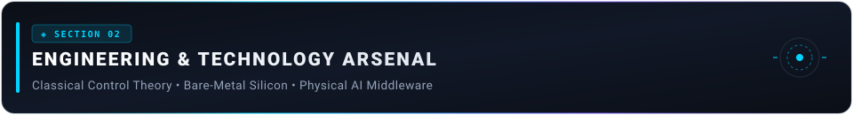

<br/>

**Languages & Runtimes**


<br/><br/>

**Robotics, Embedded & Control**


&nbsp;&nbsp;


<br/><br/>

**Engineering & Simulation Tools**


<br/><br/>

**Cloud, AI & Dev Tools**


</div>

---

<!-- ═══════════════════════════════════════════════════════════════════
     SECTION 3 — MATHEMATICAL FOUNDATIONS (preserved)
     ═══════════════════════════════════════════════════════════════════ -->

<div align="center">
  
</div>

> *"Safety is not a feature or a soft prompt. It is a deterministic mathematical law."*  
> Across all engineered systems, high-level AI directives are certified through formal non-linear control theory, Lyapunov stability, state estimation, and Galois field embedded communications.

<table>
  <tr>
    <td width="50%" valign="top">
      <h4>🛡️ 1. Control Barrier Functions (CBF-QP) — Forward Invariance</h4>
      <p>Under continuous-time unicycle assumptions, ensures that robot states remain within the safe admissible set $\mathcal{C}$:</p>
      $$\dot{h}(x, u) = \nabla h(x)^T \dot{x} = L_f h(x) + L_g h(x) u \ge -\alpha(h(x))$$
      <p>The safety filter projects unsafe AI inputs $u_{\text{AI}}$ onto the safe set in sub-millisecond real-time:</p>
      $$u^*(x) = \arg\min_{u \in \mathcal{U}} \frac{1}{2} \|u - u_{\text{AI}}\|_Q^2 \quad \text{s.t.} \quad L_f h_i(x) + L_g h_i(x) u \ge -\gamma_i h_i(x)$$
      <sub><b>Realization:</b> <code>principia-robotica</code> (Python + C++17) · 31.5 µs median latency (&gt;20,000 Hz) · 68/68 tests</sub>
    </td>
    <td width="50%" valign="top">
      <h4>🎯 2. Control Lyapunov Functions (CLF) — Asymptotic Stability</h4>
      <p>Guarantees exponential state convergence to target trajectory $x^* = 0$ via positive-definite energy decay:</p>
      $$\dot{V}(x, u) = \nabla V(x)^T \dot{x} = L_f V(x) + L_g V(x) u \le -\gamma V(x)$$
      <p>Unified CLF-CBF-QP co-design with slack $\delta \ge 0$ prioritizes hard safety over performance:</p>
      $$\min_{u \in \mathcal{U}, \, \delta \ge 0} \frac{1}{2} \|u - u_{\text{des}}\|_Q^2 + \frac{1}{2} p \, \delta^2 \quad \text{s.t.} \quad \dot{V} \le -\gamma V + \delta, \;\; \dot{h} \ge -\alpha(h)$$
      <sub><b>Realization:</b> <code>automotive-chassis-cbf</code> · +35.65% RMS ride comfort · ±50 mm stroke invariant</sub>
    </td>
  </tr>
  <tr>
    <td width="50%" valign="top">
      <h4>📡 3. Extended Kalman Filter (EKF) — Sensor Fusion</h4>
      <p>Fuses high-rate 6-axis IMU angular rates with discrete sensor observations under non-linear dynamics:</p>
      $$K_k = P_{k|k-1} H_k^T \left( H_k P_{k|k-1} H_k^T + R_k \right)^{-1}$$
      $$\hat{x}_{k|k} = \hat{x}_{k|k-1} + K_k \left( z_k - h(\hat{x}_{k|k-1}) \right)$$
      <p>Joseph stabilized covariance update guarantees positive-definiteness ($P_{k|k} \succ 0$) on microcontrollers:</p>
      $$P_{k|k} = (I - K_k H_k) P_{k|k-1} (I - K_k H_k)^T + K_k R_k K_k^T$$
      <sub><b>Realization:</b> Autonomous Racing Drone &amp; Hexapod · ESP32 / STM32 · &lt;2° attitude error · 40% latency cut</sub>
    </td>
    <td width="50%" valign="top">
      <h4>🦾 4. Multibody Dynamics &amp; Singularity-Robust Kinematics</h4>
      <p>Euler-Lagrange equations of motion for multi-DOF articulated robots with skew-symmetric passivity:</p>
      $$M(q)\ddot{q} + C(q, \dot{q})\dot{q} + g(q) = \tau, \quad x^T \left( \dot{M}(q) - 2C(q, \dot{q}) \right) x = 0$$
      <p>Damped Least Squares (DLS) inverse kinematics with null-space manipulability $w(q)$ optimization:</p>
      $$\dot{q} = J^\dagger_\lambda \mathbf{v}_e + \left( I - J^\dagger_\lambda J \right) \nabla_q w(q), \quad J^\dagger_\lambda = J^T \left( J J^T + \lambda^2 I \right)^{-1}$$
      <sub><b>Realization:</b> <code>project-spidey-hexapod</code> (18-DOF) &amp; 3-DOF Arm · ±1 mm physical repeatability</sub>
    </td>
  </tr>
  <tr>
    <td colspan="2" valign="top">
      <h4>⚡ 5. Finite Field CRC-8 Polynomials — Deterministic Real-Time Comms</h4>
      <p>AUTOSAR E2E Profile 1 Galois Field $\text{GF}(2)$ data protection across high-speed serial/CAN backbones using SAE J1850 polynomial $G(x) = x^8 + x^4 + x^3 + x^2 + 1$ ($0\text{x}1\text{D}$):</p>
      $$\text{CRC}(x) = \left( x^8 M(x) \oplus x^{8(L+3)} \sum_{i=0}^7 x^i \right) \bmod G(x) \oplus \sum_{i=0}^7 x^i$$
      <p>Full <b>AUTOSAR E2E Profile 1 protocol framing</b> encapsulates short telemetry frames ($L \le 8$ bytes) with a 4-bit monotonic sequence counter, Data ID, and SAE J1850 CRC-8 over Galois Field $\text{GF}(2)$, ensuring $d_{\min} \ge 4$ fault detection. The primitive polynomial $G(x)$ features maximal period $2^8 - 1 = 255$ bits, guaranteeing 100% detection of burst errors $b \le 8$ bits and $99.61\%$ ($1 - 2^{-8}$) of burst errors $b > 8$ bits. Implemented as an $O(1)$ constant-time lookup table executing in $< 35\,\mu\text{s}$ on ARM Cortex-M4.</p>
      <sub><b>Realization:</b> <code>ros2-hardware-bridge</code> (<code>firmware/ros2_bridge.h</code>) · STM32F4 / RP2040 · Zero packet loss</sub>
    </td>
  </tr>
</table>

---

<!-- ═══════════════════════════════════════════════════════════════════
     SECTION 4 — 4-TIER ARCHITECTURE (preserved)
     ═══════════════════════════════════════════════════════════════════ -->

<div align="center">
  
</div>

Modern autonomous robotics and Physical AI require deterministic safety guarantees from cloud AI down to bare-metal silicon. The standard paradigm of treating physical actuators as unconstrained API endpoints introduces catastrophic failure modes. Safety cannot be treated as a heuristic or soft prompt; **safety must be enforced as a mathematically invariant law**.

The 7 flagship repositories authored by **Engineer Abdullah Bin Zafar** form an integrated 4-tier cyber-physical architecture:

```
┌────────────────────────────────────────────────────────────────────────────────────────┐
│                          TIER 1: PHYSICAL AI & AGENTIC MIDDLEWARE                      │
│   antigravity-robotics-plugin · ros2-mcp-server · 3-Tier Command Sandbox               │
│   JSON-RPC 2.0 (stdio) · 1000Hz Fast-Forward Kinematics · 2D Spatial LiDAR Radar       │
└───────────────────────────────────────────▲────────────────────────────────────────────┘
                                            │ Proposed AI Command u_AI (v, ω)
┌───────────────────────────────────────────┴────────────────────────────────────────────┐
│                    TIER 2: FORMAL SAFETY CERTIFICATION & INVARIANT FILTER              │
│   principia-robotica · Control Barrier Functions (CBF-QP) · Control Lyapunov (CLF)     │
│   Strict Forward Invariance h(x) ≥ 0 · 31.5 us KKT Optimization (>20,000 Hz)           │
└───────────────────────────────────────────▲────────────────────────────────────────────┘
                                            │ Certified Safe Command u*
┌───────────────────────────────────────────┴────────────────────────────────────────────┐
│                  TIER 3: DETERMINISTIC EMBEDDED BRIDGE & REAL-TIME COMMS               │
│   ros2-hardware-bridge · STM32 HAL/LL · AUTOSAR E2E Profile 1 · SAE J1850 CRC-8       │
│   COBS Framing · Deterministic Ring Buffers · <35 µs Processing · Hamming Dist d ≥ 4   │
└───────────────────────────────────────────▲────────────────────────────────────────────┘
                                            │ High-Speed Serial / CAN Bus (921.6 kbaud)
┌───────────────────────────────────────────┴────────────────────────────────────────────┐
│               TIER 4: CHAOS ENGINEERING, FUZZING & HIGH-ASSURANCE VERIFICATION         │
│   ros-fault-injector · failure-atlas · stm32-hal-fuzzer                                │
│   Stochastic Packet Dropping · AWGN Sensor Noise · AFL-Style HAL Register Fuzzing      │
└───────────────────────────────────────────▲────────────────────────────────────────────┘
                                            │ Closed-Loop Physical Feedback
┌───────────────────────────────────────────┴────────────────────────────────────────────┐
│                              PHYSICAL ROBOTIC & HARDWARE ARTIFACTS                     │
│   18-DOF Hexapod (SPIDEY FYP) · 3-DOF Arm (±1mm) · Racing Drone (<2°) · Automotive CBF │
└────────────────────────────────────────────────────────────────────────────────────────┘
```

#### Core Mathematical Guarantees Across the 4 Tiers

**Tier 1 — Agentic Kinematics & Collision Prediction**

For a mobile base in $\text{SE}(2)$ with state $\mathbf{x} = [x, y, \theta]^T$, the fast-forward predictor evaluates Time-To-Collision ($\text{TTC}$) over horizon $T$:

$$\begin{bmatrix} \dot{x} \\ \dot{y} \\ \dot{\theta} \end{bmatrix} = \begin{bmatrix} v \cos\theta \\ v \sin\theta \\ \omega \end{bmatrix}, \qquad \text{TTC} = \inf \{ t_k : \|\mathbf{p}(t_k) - \mathbf{p}_{\text{obs}}\|_2 \le r_{\text{obs}} + r_{\text{robot}} \}$$

**Tier 2 — Control Barrier Function Quadratic Programming**

Given an unconstrained AI velocity command $\mathbf{u}_{\text{AI}} \in \mathbb{R}^m$, the safety filter projects onto the safe admissible set via strictly convex Quadratic Programming:

$$\mathbf{u}^* = \arg\min_{\mathbf{u} \in \mathcal{U}} \frac{1}{2} \|\mathbf{u} - \mathbf{u}_{\text{AI}}\|_Q^2 \quad \text{s.t.} \quad L_f h(\mathbf{x}) + L_g h(\mathbf{x}) \mathbf{u} \ge -\gamma(h(\mathbf{x}))$$

Under continuous-time assumptions (Nagumo's Theorem & Ames et al.), forward invariance holds on $\mathcal{C}$:

$$\mathbf{x}(0) \in \mathcal{C} \implies \mathbf{x}(t) \in \mathcal{C} \quad \forall t \ge 0, \qquad \mathcal{C} = \{\mathbf{x} \in \mathbb{R}^n : h(\mathbf{x}) \ge 0\}$$

**Tier 3 — AUTOSAR E2E Profile 1 Integrity & CRC-8**

Serial telemetry framing combines a 4-bit monotonic sequence counter, Data ID, and the SAE J1850 primitive generator polynomial over $\text{GF}(2)$:

$$G(x) = x^8 + x^4 + x^3 + x^2 + 1 \quad (0\text{x}1\text{D}), \qquad T = 2^8 - 1 = 255\text{ bits}$$

AUTOSAR E2E Profile 1 framing guarantees $d_{\min} \ge 4$ fault detection for short telemetry frames ($L \le 8$ bytes), detecting 100% of burst errors $b \le 8$ bits and $99.61\%$ ($1 - 2^{-8}$) for $b > 8$ bits.

**Tier 4 — Stochastic Fault Injection & Reliability**

Continuous sensor channels are perturbed via Additive White Gaussian Noise (AWGN):

$$\tilde{\mathbf{s}}(t) = \mathbf{s}(t) + \boldsymbol{\eta}(t), \qquad \boldsymbol{\eta}(t) \sim \mathcal{N}(\mathbf{0}, \mathbf{\Sigma})$$

with explicit $L_2$ projective quaternion re-normalization $\mathbf{q} \leftarrow \mathbf{q} / \|\mathbf{q}\|_2$ preserving $\text{SO}(3)$ manifold integrity.

---

<!-- ═══════════════════════════════════════════════════════════════════
     SECTION 5 — FLAGSHIP PROJECTS (preserved + enhanced cards)
     ═══════════════════════════════════════════════════════════════════ -->

<div align="center">
  
</div>


### 🛡️ Commercial Physical AI Safety — Micro-SaaS & Hosted Gateway

<table width="100%">
  <tr>
    <td width="100%" valign="top">
      <h3>
        <a href="https://github.com/EngineerAbdullahBinZafar/safemotion-ai">
          🛡️ SafeMotion AI — Deterministic Physical AI Safety Shield (FastAPI + MCP Gateway)
        </a>
        &nbsp;
        
        
        
        
      </h3>
      <p><b>Commercial-grade, sub-millisecond mathematical safety shield for Embodied AI agents and autonomous mobile robots (AMRs).</b><br/>
      Intercepts unconstrained neural velocity commands from LLMs (Claude, GPT-4, Gemini) and projects them in real time onto forward-invariant safe sets via closed-form Control Barrier Functions (CBF-QP) at &gt;20,000 Hz. Enforces forward-invariance under ideal unicycle model assumptions to prevent barrier boundary violations.</p>
      <table>
        <tr>
          <td align="center" width="25%">
            <br/>
            <sub>Sub-50µs high-throughput endpoint</sub>
          </td>
          <td align="center" width="25%">
            <br/>
            <sub>Stdio &amp; SSE agent tool bridge</sub>
          </td>
          <td align="center" width="25%">
            <br/>
            <sub>h(x) &ge; 0 mathematical safety certificate</sub>
          </td>
          <td align="center" width="25%">
            <br/>
            <sub>Sub-50µs REST / Stdio / SSE</sub>
          </td>
        </tr>
      </table>
    </td>
  </tr>
</table>

---


### 🏎️ Advanced Automotive Control & Invariant Suspensions

<table width="100%">
  <tr>
    <td width="100%" valign="top">
      <h3>
        <a href="https://github.com/EngineerAbdullahBinZafar/automotive-chassis-cbf">
          ⚡ Automotive Chassis CBF — HOCBF (r=2) + Real-Time MPC + AUTOSAR E2E CAN
        </a>
        &nbsp;
        
        
        
      </h3>
      <p><b>Active chassis research framework implementing quarter-car active suspension with HOCBF and discrete-time MPC, evaluated against ISO 8608 Class A road profiles in simulation.</b><br/>
      Integrates a 100 Hz condensed linear MPC planner with DARE infinite-horizon terminal cost, a relative-degree $r=2$ High-Order Control Barrier Function (HOCBF) closed-form safety shield, physical actuator strut saturation/thermal dynamics, and an AUTOSAR E2E Profile 1 CAN telemetry gateway (<code>chassis_dynamics.dbc</code>).</p>
      <table>
        <tr>
          <td align="center" width="25%">
            <br/>
            <sub>Over passive baseline on ISO 8608 Class A roads</sub>
          </td>
          <td align="center" width="25%">
            <br/>
            <sub>Median · &lt;3% CPU load at 100 Hz</sub>
          </td>
          <td align="center" width="25%">
            <br/>
            <sub>HOCBF hard constraint · never violated</sub>
          </td>
          <td align="center" width="25%">
            <br/>
            <sub>Full suite · zero regressions</sub>
          </td>
        </tr>
      </table>
    </td>
  </tr>
</table>

---

### 🤖 Physical AI Safety — Robotics Core Stack

<table width="100%">
  <tr>
    <td width="50%" valign="top">
      <h3>
        <a href="https://github.com/EngineerAbdullahBinZafar/principia-robotica">
          🛡️ principia-robotica
        </a>
        &nbsp;
        
      </h3>
      <p>Real-time CBF-QP safety filter for 2D unicycle robots. Projects any unsafe AI velocity command $(v, \omega)$ onto the safe set using closed-form minimum-norm gradient correction. Dual Python + zero-allocation C++17 (<code>cpp/</code>) implementation running at 31.5 µs median latency (&gt;20,000 Hz throughput).</p>
      <p><code>python demo.py</code> → ASCII map showing unfiltered crash vs. CBF-deflected safe trajectory</p>
      <p>
        
        
        
      </p>
    </td>
    <td width="50%" valign="top">
      <h3>
        <a href="https://github.com/EngineerAbdullahBinZafar/antigravity-robotics-plugin">
          🌌 antigravity-robotics-plugin
        </a>
        &nbsp;
        
      </h3>
      <p>MCP server plugin for Antigravity IDE — bridges AI agents to physical robot hardware through a 3-tier command sandbox. Enforces 3-tier command sandboxing and real-time telemetry for AI-driven robotics. 2D LiDAR HTML5 radar, PID auto-tuner, 30 Hz telemetry.</p>
      <p>
        
        
        
      </p>
    </td>
  </tr>
  <tr>
    <td width="50%" valign="top">
      <h3>
        <a href="https://github.com/EngineerAbdullahBinZafar/ros2-mcp-server">
          📡 ros2-mcp-server
        </a>
        &nbsp;
        
      </h3>
      <p>Standalone JSON-RPC 2.0 (stdio) MCP server exposing ROS 2 topics, nodes, diagnostics, PID tuning, and spatial mapping to any MCP-compatible AI agent. Enforces 3-tier security sandbox before commands reach actuators.</p>
      <p>
        
        
      </p>
    </td>
    <td width="50%" valign="top">
      <h3>
        <a href="https://github.com/EngineerAbdullahBinZafar/ros2-hardware-bridge">
          🔗 ros2-hardware-bridge
        </a>
        &nbsp;
        
      </h3>
      <p>Deterministic STM32 HAL/LL firmware bridge with AUTOSAR E2E Profile 1 CRC-8 framing, COBS byte-stuffing, ring-buffer DMA, and auto-resync after garbage injection. &lt;35 µs processing latency at 921.6 kbaud.</p>
      <p>
        
        
        
      </p>
    </td>
  </tr>
</table>

---

### 🔬 Chaos Engineering & High-Assurance Verification

<table width="100%">
  <tr>
    <td width="33%" valign="top">
      <h3>
        <a href="https://github.com/EngineerAbdullahBinZafar/ros-fault-injector">
          💥 ros-fault-injector
        </a>
        &nbsp;
        
      </h3>
      <p>Stochastic chaos engineering for ROS 2 — IMU Gaussian noise, LiDAR beam dropout, WiFi latency/drop. Zero-dependency <code>demo.py</code> with ASCII sparklines.</p>
    </td>
    <td width="33%" valign="top">
      <h3>
        <a href="https://github.com/EngineerAbdullahBinZafar/failure-atlas">
          📚 failure-atlas
        </a>
        &nbsp;
        
      </h3>
      <p>Structured database of 12 real-world engineering failures (Ariane 5, Therac-25, Mars Climate Orbiter, Boeing 737 MAX MCAS) with FMEA RPN scoring.</p>
    </td>
    <td width="33%" valign="top">
      <h3>
        <a href="https://github.com/EngineerAbdullahBinZafar/stm32-hal-fuzzer">
          🔀 stm32-hal-fuzzer
        </a>
        &nbsp;
        
      </h3>
      <p>AFL-style property-based fuzzer for 28 STM32 HAL APIs — NULL pointers, zero-size, extreme values. Exports C harness for real AFL/libFuzzer integration.</p>
    </td>
  </tr>
</table>

---

<!-- ═══════════════════════════════════════════════════════════════════
     SECTION 6 — BARE-METAL C/C++ SYSTEMS & HARDWARE SCHEMATICS
     ═══════════════════════════════════════════════════════════════════ -->

### ⚙️ Native C11 / C++17 Embedded Firmware & Hardware PCB Schematics

To keep real-time control loops deterministic from silicon registers up to ROS 2 DDS middleware, core safety drivers and CAN controllers are implemented in **strict zero-heap C11 and C++17**, continuously compiled and sanitized under `-Wall -Wextra -Werror -fsanitize=address,undefined` via GitHub Actions:

| Repository / Subsystem | Core Languages | Verified Engineering Scope & Hardware Realization | Hardware Topology / Spec |
| :--- | :--- | :--- | :--- |
| [**`ros2-hardware-bridge`**](https://github.com/EngineerAbdullahBinZafar/ros2-hardware-bridge) | **C11 · C++17** | 7-state AUTOSAR E2E Profile 1 parser, static 512B SPSC DMA ring buffer, COBS codec, & `SerialE2ECodec` host wrapper | [Wiring & Isolator SVG](https://github.com/EngineerAbdullahBinZafar/ros2-hardware-bridge/blob/main/docs/assets/stm32_uart_can_topology.svg) |
| [**`zephyr-can-fault-injection`**](https://github.com/EngineerAbdullahBinZafar/zephyr-can-fault-injection) | **C11 · Zephyr** | Lock-free In-ISR token-bucket `ERRINT` log rate limiter & ISO 11898-1:2015 Bus-Off auto-recovery state machine | [FlexCAN ISR FSM SVG](https://github.com/EngineerAbdullahBinZafar/zephyr-can-fault-injection/blob/main/docs/assets/flexcan_errint_rate_limiter_arch.svg) |
| [**`stm32-hal-fuzzer`**](https://github.com/EngineerAbdullahBinZafar/stm32-hal-fuzzer) | **C11 · AFL/LLVM** | Contract-verified C11 HAL peripheral precondition checker (NULL handles, zero DMA lengths, PLL clock bounds) across 28 APIs | [C11 Harness & ASan](https://github.com/EngineerAbdullahBinZafar/stm32-hal-fuzzer/tree/main/c_harness) |
| [**`principia-robotica/cpp`**](https://github.com/EngineerAbdullahBinZafar/principia-robotica/tree/main/cpp) | **C++17 · CMake** | Zero-allocation active-set KKT / Dykstra CBF-QP filter with box actuator bounds & Euler closed-loop verification | [C++17 Solver Source](https://github.com/EngineerAbdullahBinZafar/principia-robotica/tree/main/cpp) |
| [**`antigravity-robotics-plugin`**](https://github.com/EngineerAbdullahBinZafar/antigravity-robotics-plugin/tree/main/ros2_packages) | **C++17 · rclcpp** | Deterministic `rclcpp_lifecycle::LifecycleNode` controller (`antigravity_core`) & custom Qt `rviz_common::Panel` | [ROS 2 C++ Packages](https://github.com/EngineerAbdullahBinZafar/antigravity-robotics-plugin/tree/main/ros2_packages) |

<p align="center">
  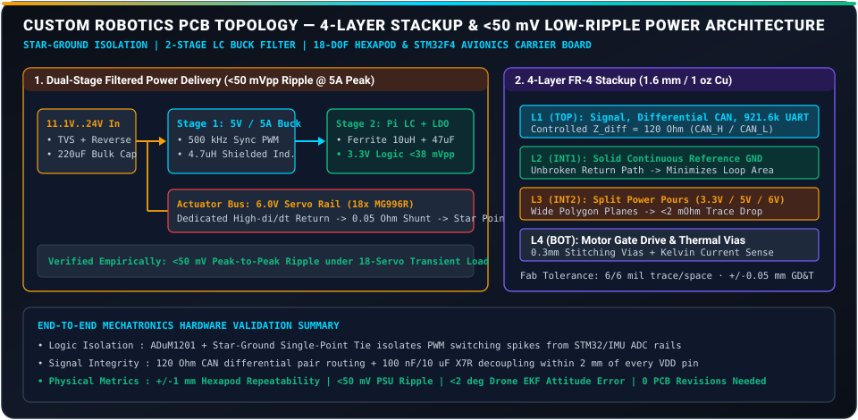
</p>

<br/>

<p align="center">
  <b>Cross-Repository Subsystem Topologies:</b>
  <a href="https://github.com/EngineerAbdullahBinZafar/ros2-hardware-bridge/blob/main/docs/assets/stm32_uart_can_topology.svg">STM32 ADuM1201 + CAN Bus Wiring</a> ·
  <a href="https://github.com/EngineerAbdullahBinZafar/automotive-chassis-cbf/blob/main/docs/assets/quarter_car_hil_topology.svg">Quarter-Car Active Suspension HIL Schematic</a> ·
  <a href="https://github.com/EngineerAbdullahBinZafar/zephyr-can-fault-injection/blob/main/docs/assets/flexcan_errint_rate_limiter_arch.svg">Zephyr CAN ISR Rate Limiter Topology</a>
</p>

---

<!-- ═══════════════════════════════════════════════════════════════════
     SECTION 7 — HEXAPOD FYP SHOWCASE (preserved)
     ═══════════════════════════════════════════════════════════════════ -->

<div align="center">
  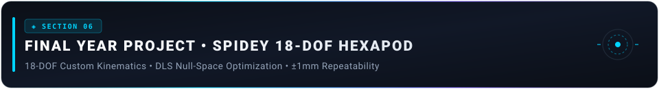
</div>

<div align="center">


</div>

<br/>

**SPIDEY** is an 18-DOF hexapod robot built from scratch as the Final Year Project at UET Lahore. Every component — from the custom PCB layout to the CNC-machined aluminum frame — was designed, fabricated, and validated by **Abdullah Bin Zafar**.

<table>
  <tr>
    <td align="center" width="25%">
      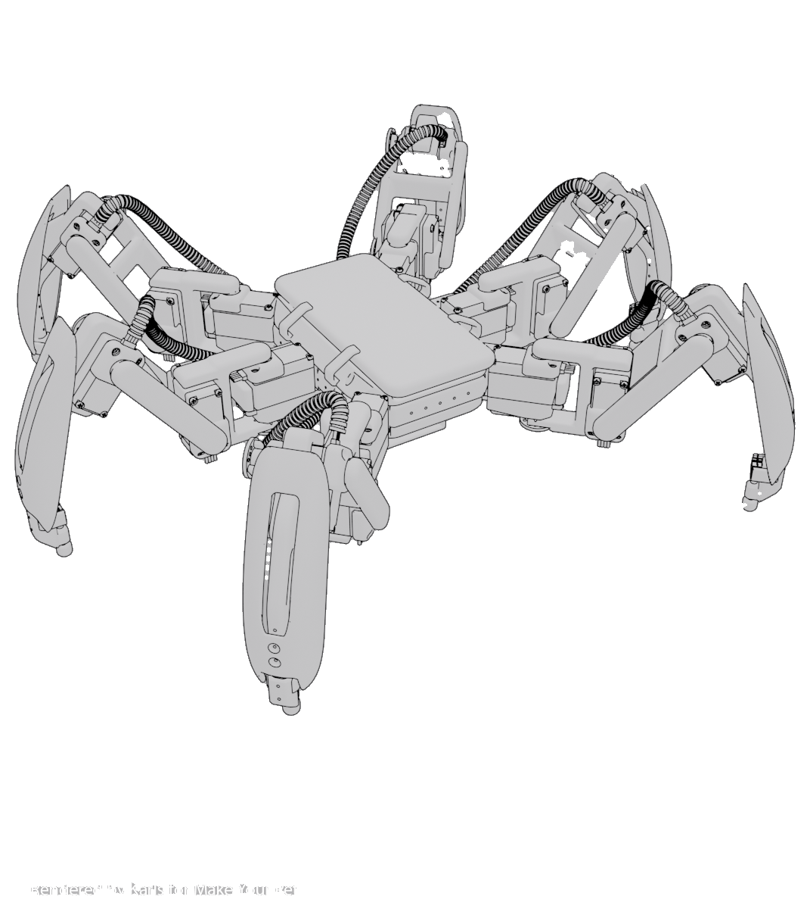
      <br/><sub><b>Front View</b></sub>
    </td>
    <td align="center" width="25%">
      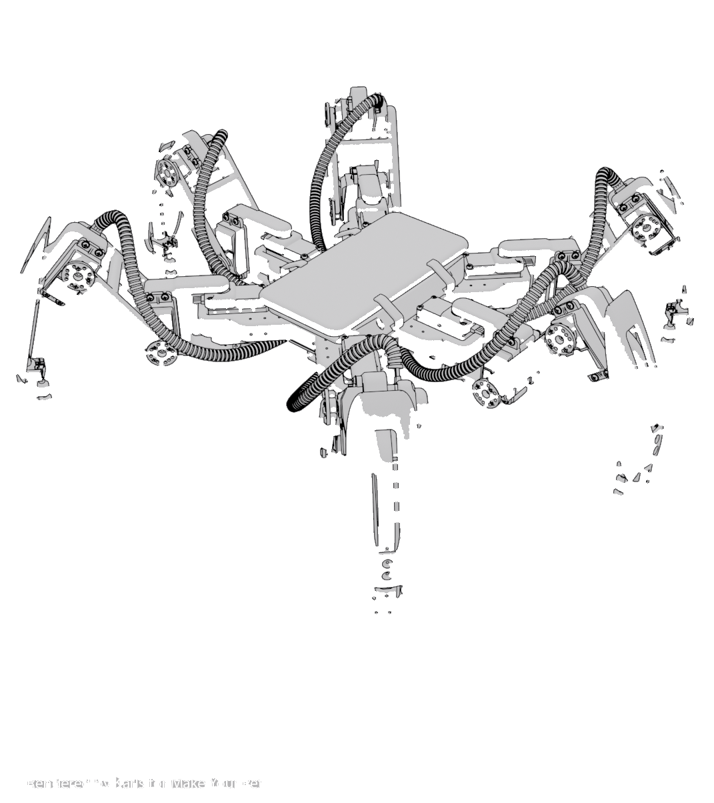
      <br/><sub><b>Back View</b></sub>
    </td>
    <td align="center" width="25%">
      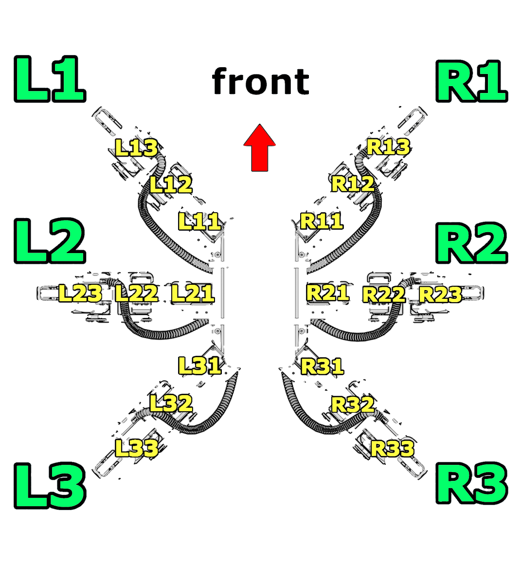
      <br/><sub><b>Top View</b></sub>
    </td>
    <td align="center" width="25%">
      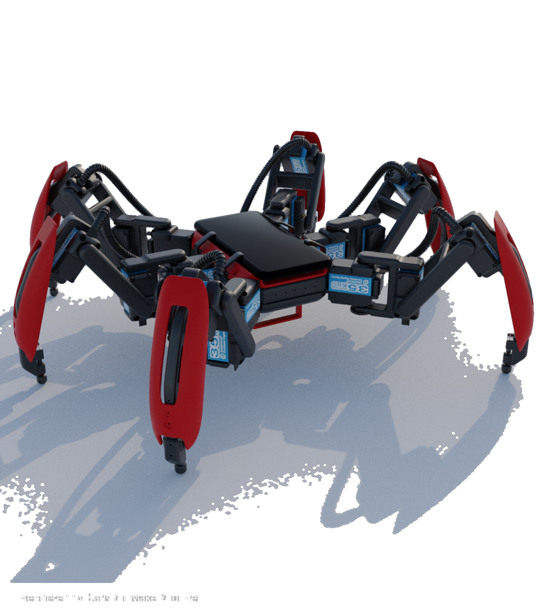
      <br/><sub><b>Hero Shot</b></sub>
    </td>
  </tr>
</table>

<table>
  <tr>
    <td align="center" width="50%">
      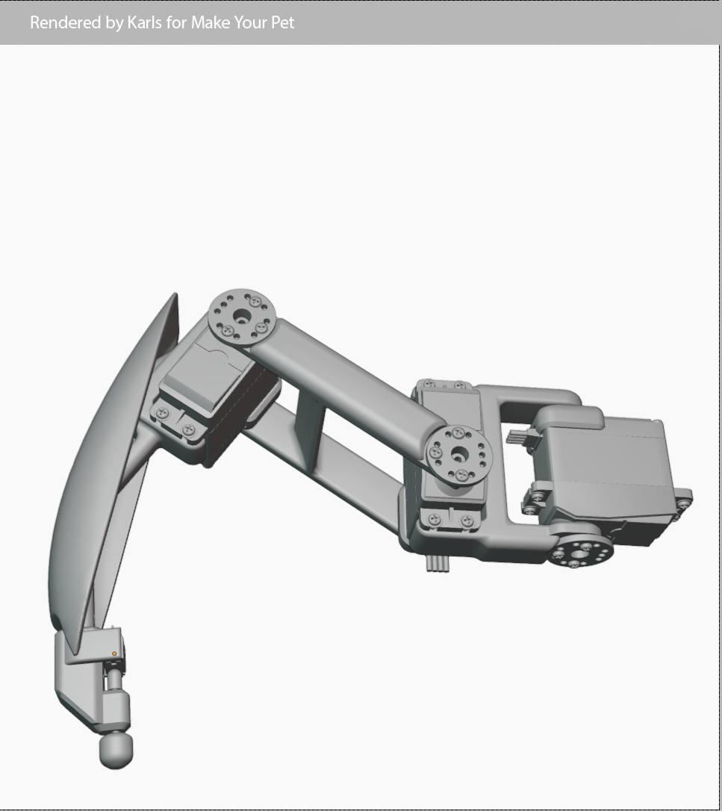
      <br/><sub><b>Servo Orientation & DOF Mapping</b></sub>
    </td>
    <td align="center" width="50%">
      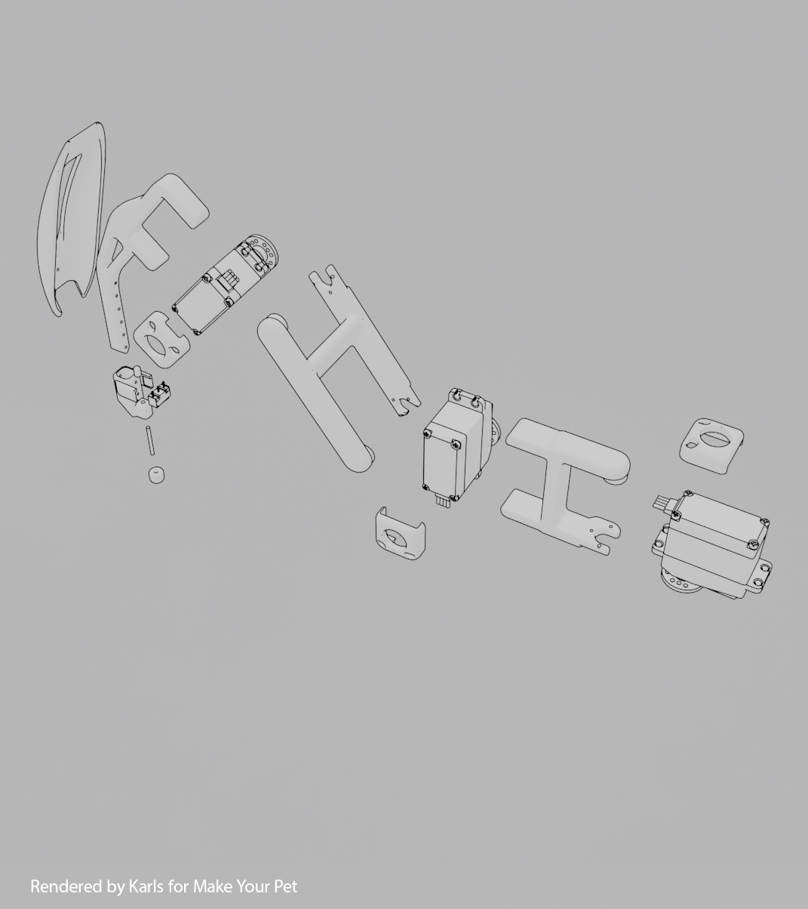
      <br/><sub><b>Leg Component Assembly</b></sub>
    </td>
  </tr>
</table>

**Technical Specifications:**

| Parameter | Value |
| :--- | :--- |
| **DOF** | 18 (3 per leg × 6 legs) |
| **Control MCU** | ESP32 (gait planner) + STM32 (servo driver) |
| **Inverse Kinematics** | DLS (Damped Least Squares) with null-space optimization |
| **Positional Repeatability** | ±1 mm |
| **Servo Torque** | 20 kg·cm (MG996R) |
| **Communication** | CAN bus + UART at 921.6 kbaud |
| **Safety Layer** | CBF-QP forward invariance via `principia-robotica` |

---

<!-- ═══════════════════════════════════════════════════════════════════
     SECTION 8 — INTERLOOP INDUSTRIAL INTERNSHIP (preserved)
     ═══════════════════════════════════════════════════════════════════ -->

<div align="center">
  
</div>

**Executive Intern Engineer** | Plant 2 HD2, Khurrianwala | August 26 – September 26, 2026

<details>
<summary><b>🔍 Expand: Industrial Plant Engineering Details & Evidence</b></summary>

<br/>

Interloop Limited is Pakistan's largest hosiery and textile exporter — a **Fortune 500-class** manufacturing operation with 56,000+ employees and exports to H&M, Nike, Levi's, and Target. The internship involved hands-on engineering work on:

- **Wärtsilä V16 7.8 MW Cogeneration Plant** — thermal load analysis, vibration signature monitoring
- **1,818 Lonati Circular Knitting Robots** — servo maintenance, PLC ladder logic audit
- **3-Stage Pneumatic Valve Sequencing** — pressure-drop failure mode analysis
- **Closed-Loop HVAC Telemetry** — ±2% RH setpoints, chiller control loop tuning

<br/>

<table>
  <tr>
    <td align="center" width="33%">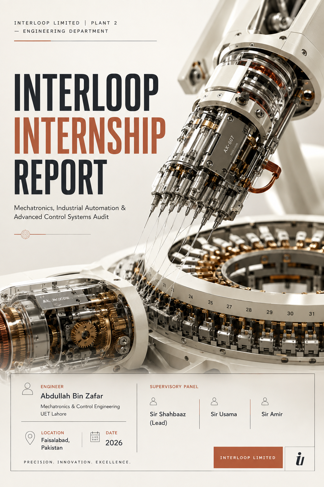<br/><sub>Plant Overview</sub></td>
    <td align="center" width="33%">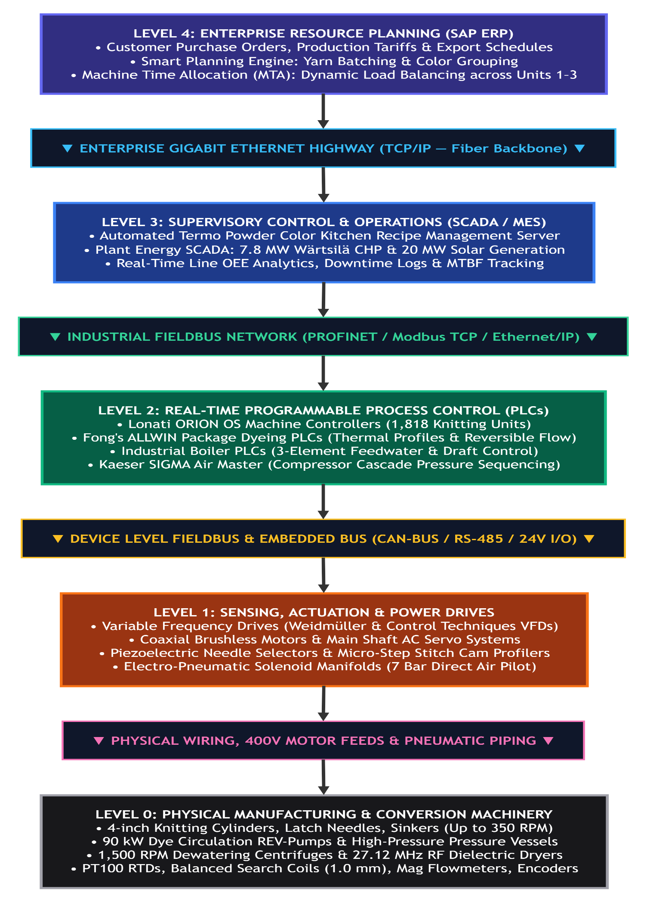<br/><sub>Knitting Robot Hall</sub></td>
    <td align="center" width="33%"><br/><sub>Cogeneration Plant</sub></td>
  </tr>
  <tr>
    <td align="center" width="33%">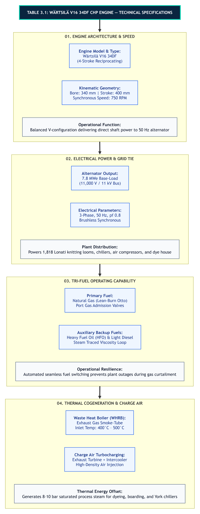<br/><sub>Control Panel</sub></td>
    <td align="center" width="33%">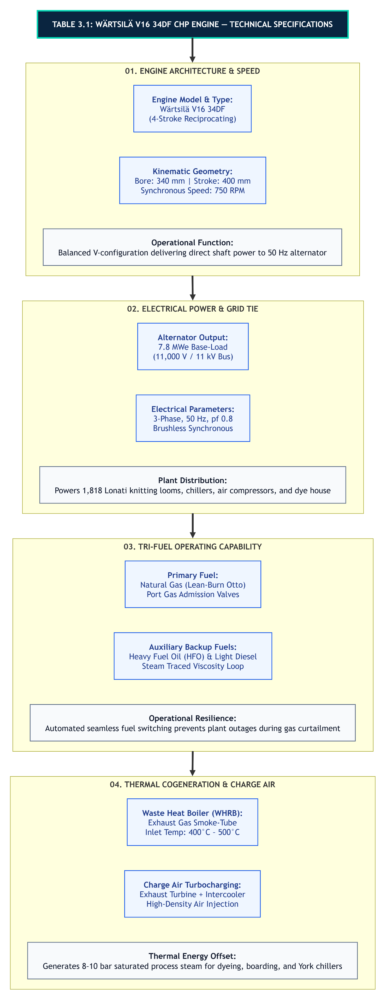<br/><sub>Pneumatic Valves</sub></td>
    <td align="center" width="33%">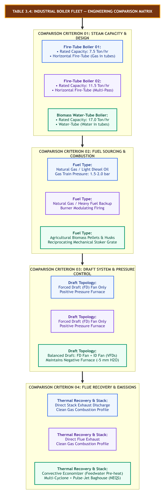<br/><sub>HVAC Monitoring</sub></td>
  </tr>
  <tr>
    <td align="center" width="33%">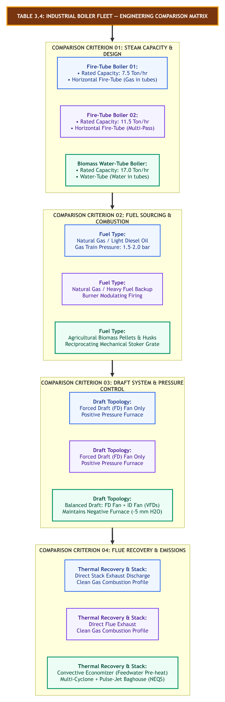<br/><sub>Servo Drive Array</sub></td>
    <td align="center" width="33%">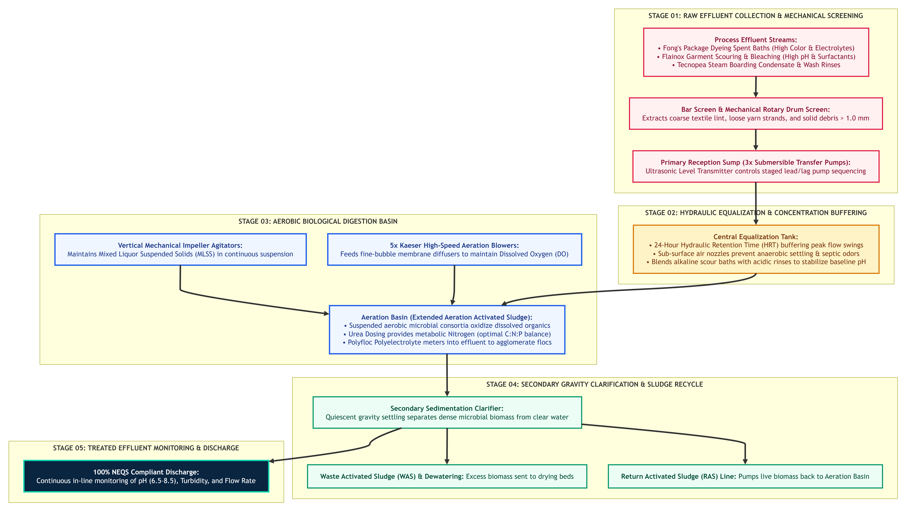<br/><sub>PCB Inspection</sub></td>
    <td align="center" width="33%">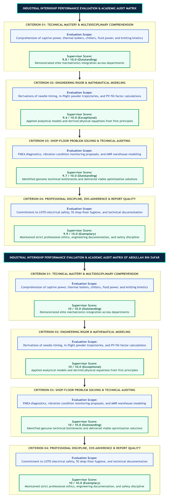<br/><sub>Plant 2 HD2</sub></td>
  </tr>
</table>

</details>

---

<!-- ═══════════════════════════════════════════════════════════════════
     SECTION 9 — ACADEMIC RECORD (preserved)
     ═══════════════════════════════════════════════════════════════════ -->

<div align="center">
  
</div>

<details>
<summary><b>📋 Expand: Full 6-Semester Course Record with Hardware Outcomes</b></summary>

<br/>

| Course | Instructor | Hardware / Software Deliverable |
| :--- | :--- | :--- |
| **Robotics & Automation** | *Dr. Bilal A. Bhatti* | **18-DOF Hexapod (SPIDEY FYP):** DLS-IK · CAN bus · custom PCB · ±1 mm repeatability |
| **Control Systems Design** | *Dr. M. Suleman Bhatti* | **Autonomous Drone (Attitude Hold):** EKF sensor fusion · PID cascade · &lt;2° attitude error |
| **Digital Signal Processing** | *Umar Siddique Virk* | **Real-Time Audio FFT:** ARM CMSIS-DSP · 44.1 kHz · STM32 DAC output |
| **Microprocessors & Embedded** | *Faculty Team* | **STM32 Motor Driver:** DRV8833 · H-bridge · encoder feedback · closed-loop velocity control |
| **Computer Vision Navigation** | *Faculty Team* | **Vision-Guided Line UAV:** Real-time OpenCV on custom KiCad PCB · centerline deviation &lt;15 mm |
| **Electrical Machinery & Power** | *Umar Siddique Virk* | **Regulated AC/DC PSU:** Transformer → full-wave bridge → LC filter → &lt;50 mV output voltage ripple |
| **Industrial Hydraulics & Pneumatics** | *Dr. M. Awais Hafeez* | **Automated Safety Door:** 3-stage valve pressure-drop analysis · staged electro-pneumatic interlocks |
| **Machine Design & Elements** | *Dr. Imran Ali* | **Fatigue Life & Gear Train:** Multi-stage shaft &amp; bearing design in SolidWorks under cyclic loading → Grade A |
| **Digital Logic Design** | *M. Zia Ur Rahman* | **Logic State Machines:** Combinational &amp; sequential circuits · FSMs on breadboard &amp; FPGA simulation |
| **Engineering Mechanics** | *Dr. Ammara Kanwal* | **Load-Bearing Folding Mechanism:** Shear-force &amp; bending-moment predictions validated within 5% of theoretical |
| **Instrumentation & Systems** | *Faculty Team* | **Sensor Calibration &amp; DAQ:** Calibration chains · active filter signal conditioning · multi-channel serial telemetry |

</details>

---

<!-- ═══════════════════════════════════════════════════════════════════
     SECTION 10 — CERTIFICATIONS (preserved)
     ═══════════════════════════════════════════════════════════════════ -->

<div align="center">
  
</div>

| Domain | Certification / Accreditation | Issuing Organization |
| :--- | :--- | :--- |
| 🎨 **Mechanical Engineering & CAD** | **Certified SolidWorks Professional (CSWP)** — Advanced 3D Modeling & Assembly Design | Dassault Systèmes |
| 📊 **Simulation & Model-Based Design** | **MATLAB Professional Certification** — Simulation & Model-Based Control Design | MathWorks |
| 🏭 **Industrial Manufacturing** | **Problem-Solving & Manufacturing Quality Certification** | Hyundai Nishat Motor (Pvt) Ltd. |
| 🧠 **AI & Machine Learning** | **Generative AI & Machine Learning Specialization** | Google / IBM / Microsoft |

---

<!-- ═══════════════════════════════════════════════════════════════════
     SECTION 11 — GITHUB TELEMETRY (enhanced)
     ═══════════════════════════════════════════════════════════════════ -->

<div align="center">

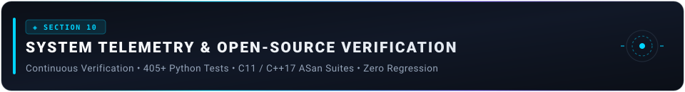

<br/>

<a href="https://github.com/EngineerAbdullahBinZafar">
  
  &nbsp;&nbsp;
  
</a>

<br/><br/>

</div>

---

<!-- ═══════════════════════════════════════════════════════════════════
     SECTION 12 — WAKA TIME / CODING STATS (optional — add token later)
     ═══════════════════════════════════════════════════════════════════ -->

<div align="center">

## ⚡ Core Technical Competencies & Tooling

| Domain | Theoretical Foundations & Methodologies | Computational Tooling & Platforms |
| :--- | :--- | :--- |
| **Control Theory & Safety** | Control Barrier Functions (CBF-QP, HOCBF), Lyapunov Stability, Discrete-Time MPC (DARE), EKF State Estimation | Python (CVXPY, NumPy, SciPy), MATLAB / Simulink |
| **Embedded & Real-Time Firmware** | Bare-Metal C/C++, AUTOSAR E2E Profile 1, CAN 2.0B / SAE J1850 CRC-8, DMA / Interrupt Architecture | STM32 (ARM Cortex-M4), Keil µVision, STM32CubeIDE |
| **Robotics Middleware & AI** | ROS 2 (Humble / Iron), micro-ROS, Model Context Protocol (MCP), URDF / Xacro kinematics | Linux / Ubuntu, Gazebo, RViz2, Docker |
| **Mechatronics & Physical Hardware** | Multi-DoF Kinematics (DLS-IK), Precision GD&T, Multi-Layer PCB Routing & Signal Integrity | SolidWorks CAD, KiCad, CNC Prototyping |

</div>

---

<!-- ═══════════════════════════════════════════════════════════════════
     SECTION 15 — OPEN FOR WORK + FOOTER
     ═══════════════════════════════════════════════════════════════════ -->

<div align="center">

## 💼 Open for Elite Engineering Opportunities

**Focus Domains**: Autonomous Vehicles & ADAS (Waymo · Tesla · BMW · Mercedes)<br/>
Mobile Robotics, Legged Locomotion & Physical AI (Boston Dynamics · Figure · Agility)<br/>
Industrial Automation, Embedded RTOS & Control Systems (Siemens · ABB · Bosch · KUKA)

<br/>

[](mailto:abz.king.1.9.2003@gmail.com)
[](https://linkedin.com/in/abdullah-bin-zafar)
<br/>

[](https://github.com/EngineerAbdullahBinZafar/principia-robotica)
[](https://github.com/EngineerAbdullahBinZafar/antigravity-robotics-plugin)
[](https://github.com/EngineerAbdullahBinZafar/automotive-chassis-cbf)

<br/><br/>

<!-- ANIMATED FOOTER WAVE -->


<sub>
<i>"Safety is not a feature or a soft prompt. It is a deterministic mathematical law."</i>
<br/>
<b>Abdullah Bin Zafar</b> · Mechatronics & Control Engineering · UET Lahore · Pakistan
<br/>

&nbsp;

</sub>

</div>
