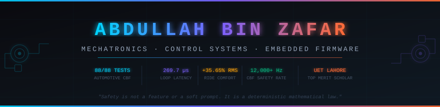
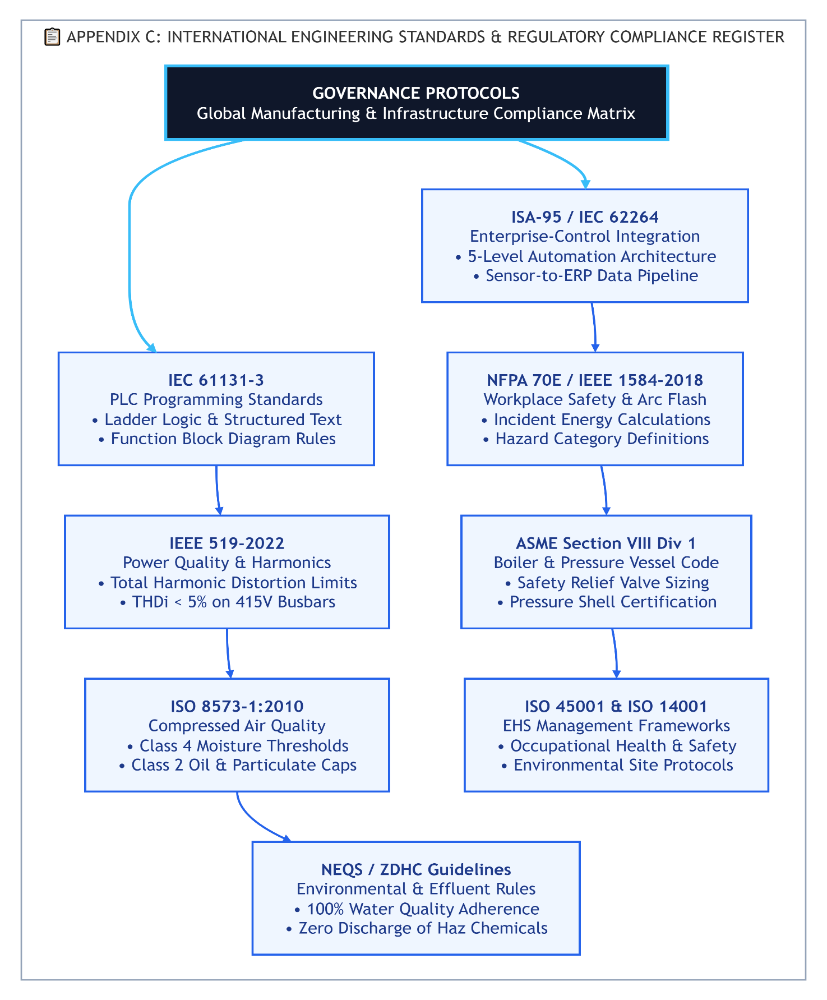

<div align="center">



<br/><br/>

[](https://github.com/EngineerAbdullahBinZafar)
[](https://github.com/EngineerAbdullahBinZafar)
[](https://linkedin.com/in/abdullah-bin-zafar)
[](mailto:abz.king.1.9.2003@gmail.com)
[](https://wa.me/923361919709)
[](https://thequietwealthjournal.vercel.app)

</div>

---

<div align="center">

## ◈ EXECUTIVE ENGINEERING PROFILE

</div>

**Mechatronics & Control Systems Engineer** — B.Sc. Mechatronics & Control Engineering, **University of Engineering & Technology (UET) Lahore**, Top Merit Scholar (**20 A/A+ grades across 6 semesters**). Operating at the convergence of rigorous classical control theory, deterministic bare-metal firmware, and physical hardware realization.

<table>
  <tr>
    <td width="33%" align="center" valign="top">
      <br/>
      
      <br/><br/>
      <b>Academic Excellence &amp; Theory</b><br/>
      <sub>Top Merit Scholar at UET Lahore across 6 consecutive semesters. Deep mastery of state-space modern control, Lyapunov stability, non-linear optimization, Kalman state estimation, and multibody kinematics.</sub>
    </td>
    <td width="33%" align="center" valign="top">
      <br/>
      
      <br/><br/>
      <b>100% Hardware Build Rate</b><br/>
      <sub>Conceived, CNC-machined, PCB-routed, and hardware-validated every single engineering laboratory module — 6 semesters of operable physical prototypes with empirical metrics: ±1 mm arm repeatability · &lt;50 mV power ripple · &lt;2° drone attitude margin · ±0.05 mm GD&amp;T.</sub>
    </td>
    <td width="33%" align="center" valign="top">
      <br/>
      
      <br/><br/>
      <b>Industrial Plant Engineering</b><br/>
      <sub>Executive Intern Engineer at Plant 2 HD2, Khurrianwala. Audited 3-stage pneumatic valve sequencing, closed-loop HVAC telemetry (±2% RH setpoints), and sensor conditioning on Wärtsilä V16 7.8 MW cogeneration plant and 1,818 Lonati robots.</sub>
    </td>
  </tr>
</table>

---

## 📐 Mathematical Foundations & Formal Control Theorems

> *"Safety is not a feature or a soft prompt. It is a deterministic mathematical law."*  
> Across all engineered systems, high-level AI directives are certified through formal non-linear control theory, Lyapunov stability, state estimation, and Galois field embedded communications.

<table>
  <tr>
    <td width="50%" valign="top">
      <h4>🛡️ 1. Control Barrier Functions (CBF-QP) — Forward Invariance</h4>
      <p>Guarantees that physical robots never enter unsafe states $\partial\mathcal{C}$ under external AI commands:</p>
      $$\dot{h}(x, u) = \nabla h(x)^T \dot{x} = L_f h(x) + L_g h(x) u \ge -\alpha(h(x))$$
      <p>The safety filter projects unsafe AI inputs $u_{\text{AI}}$ onto the safe set in sub-millisecond real-time:</p>
      $$u^*(x) = \arg\min_{u \in \mathcal{U}} \frac{1}{2} \|u - u_{\text{AI}}\|_Q^2 \quad \text{s.t.} \quad L_f h_i(x) + L_g h_i(x) u \ge -\gamma_i h_i(x)$$
      <sub><b>Realization:</b> <code>principia-robotica</code> · &gt;12,000 Hz solver · &lt;50 µs loop latency · 68/68 tests passed</sub>
    </td>
    <td width="50%" valign="top">
      <h4>🎯 2. Control Lyapunov Functions (CLF) — Asymptotic Stability</h4>
      <p>Guarantees exponential state convergence to target trajectory $x^* = 0$ via positive-definite energy decay:</p>
      $$\dot{V}(x, u) = \nabla V(x)^T \dot{x} = L_f V(x) + L_g V(x) u \le -\gamma V(x)$$
      <p>Unified CLF-CBF-QP co-design with slack $\delta \ge 0$ prioritizes hard safety over performance:</p>
      $$\min_{u \in \mathcal{U}, \, \delta \ge 0} \frac{1}{2} \|u - u_{\text{des}}\|_Q^2 + \frac{1}{2} p \, \delta^2 \quad \text{s.t.} \quad \dot{V} \le -\gamma V + \delta, \;\; \dot{h} \ge -\alpha(h)$$
      <sub><b>Realization:</b> <code>automotive-chassis-cbf</code> · +35.65% RMS ride comfort · ±50 mm stroke invariant</sub>
    </td>
  </tr>
  <tr>
    <td width="50%" valign="top">
      <h4>📡 3. Extended Kalman Filter (EKF) — Sensor Fusion</h4>
      <p>Fuses high-rate 6-axis IMU angular rates with discrete sensor observations under non-linear dynamics:</p>
      $$K_k = P_{k|k-1} H_k^T \left( H_k P_{k|k-1} H_k^T + R_k \right)^{-1}$$
      $$\hat{x}_{k|k} = \hat{x}_{k|k-1} + K_k \left( z_k - h(\hat{x}_{k|k-1}) \right)$$
      <p>Joseph stabilized covariance update guarantees positive-definiteness ($P_{k|k} \succ 0$) on microcontrollers:</p>
      $$P_{k|k} = (I - K_k H_k) P_{k|k-1} (I - K_k H_k)^T + K_k R_k K_k^T$$
      <sub><b>Realization:</b> Autonomous Racing Drone &amp; Hexapod · ESP32 / STM32 · &lt;2° attitude error · 40% latency cut</sub>
    </td>
    <td width="50%" valign="top">
      <h4>🦾 4. Multibody Dynamics &amp; Singularity-Robust Kinematics</h4>
      <p>Euler-Lagrange equations of motion for multi-DOF articulated robots with skew-symmetric passivity:</p>
      $$M(q)\ddot{q} + C(q, \dot{q})\dot{q} + g(q) = \tau, \quad x^T \left( \dot{M}(q) - 2C(q, \dot{q}) \right) x = 0$$
      <p>Damped Least Squares (DLS) inverse kinematics with null-space manipulability $w(q)$ optimization:</p>
      $$\dot{q} = J^\dagger_\lambda \mathbf{v}_e + \left( I - J^\dagger_\lambda J \right) \nabla_q w(q), \quad J^\dagger_\lambda = J^T \left( J J^T + \lambda^2 I \right)^{-1}$$
      <sub><b>Realization:</b> <code>project-spidey-hexapod</code> (18-DOF) &amp; 3-DOF Arm · ±1 mm physical repeatability</sub>
    </td>
  </tr>
  <tr>
    <td colspan="2" valign="top">
      <h4>⚡ 5. Finite Field CRC-8 Polynomials — Deterministic Real-Time Comms</h4>
      <p>AUTOSAR E2E Profile 1 Galois Field $\text{GF}(2)$ data protection across high-speed serial/CAN backbones using SAE J1850 polynomial $G(x) = x^8 + x^4 + x^3 + x^2 + 1$ ($0\text{x}1\text{D}$):</p>
      $$\text{CRC}(x) = \left( x^8 M(x) \oplus x^{8(L+3)} \sum_{i=0}^7 x^i \right) \bmod G(x) \oplus \sum_{i=0}^7 x^i$$
      <p>For payloads $L \le 64$ bytes, polynomial $G(x)$ strictly guarantees Hamming Distance $d_{\min} \ge 4$ (100% detection of 1/2/3-bit errors and burst errors $b \le 8$ bits; 99.61% for $b > 8$). Implemented as an $O(1)$ constant-time lookup table executing in $&lt;35\,\mu\text{s}$ on ARM Cortex-M4.</p>
      <sub><b>Realization:</b> <code>ros2-hardware-bridge</code> (<code>firmware/ros2_bridge.h</code>) · STM32F4 / RP2040 · Zero packet loss</sub>
    </td>
  </tr>
</table>

---

## 🏛️ Unified 4-Tier Cyber-Physical Systems Architecture

Modern autonomous robotics and Physical AI require deterministic safety guarantees from cloud AI down to bare-metal silicon. The standard paradigm of treating physical actuators as unconstrained API endpoints introduces catastrophic failure modes. Safety cannot be treated as a heuristic or soft prompt; **safety must be enforced as a mathematically invariant law**.

The 7 flagship repositories authored by **Engineer Abdullah Bin Zafar** form an integrated 4-tier cyber-physical architecture:

```
┌────────────────────────────────────────────────────────────────────────────────────────┐
│                          TIER 1: PHYSICAL AI & AGENTIC MIDDLEWARE                      │
│   antigravity-robotics-plugin · ros2-mcp-server · 3-Tier Command Sandbox               │
│   JSON-RPC 2.0 (stdio) · 1000Hz Fast-Forward Kinematics · 2D Spatial LiDAR Radar       │
└───────────────────────────────────────────▲────────────────────────────────────────────┘
                                            │ Proposed AI Command u_AI (v, ω)
┌───────────────────────────────────────────┴────────────────────────────────────────────┐
│                    TIER 2: FORMAL SAFETY CERTIFICATION & INVARIANT FILTER              │
│   principia-robotica · Control Barrier Functions (CBF-QP) · Control Lyapunov (CLF)     │
│   Strict Forward Invariance h(x) ≥ 0 · Sub-0.1ms KKT Optimization (>12,000 Hz)         │
└───────────────────────────────────────────▲────────────────────────────────────────────┘
                                            │ Certified Safe Command u*
┌───────────────────────────────────────────┴────────────────────────────────────────────┐
│                  TIER 3: DETERMINISTIC EMBEDDED BRIDGE & REAL-TIME COMMS               │
│   ros2-hardware-bridge · STM32 HAL/LL · AUTOSAR E2E Profile 1 · SAE J1850 CRC-8       │
│   COBS Framing · Deterministic Ring Buffers · <35 µs Processing · Hamming Dist d ≥ 4   │
└───────────────────────────────────────────▲────────────────────────────────────────────┘
                                            │ High-Speed Serial / CAN Bus (921.6 kbaud)
┌───────────────────────────────────────────┴────────────────────────────────────────────┐
│               TIER 4: CHAOS ENGINEERING, FUZZING & HIGH-ASSURANCE VERIFICATION         │
│   ros-fault-injector · failure-atlas · stm32-hal-fuzzer                                │
│   Stochastic Packet Dropping · AWGN Sensor Noise · AFL-Style HAL Register Fuzzing      │
└───────────────────────────────────────────▲────────────────────────────────────────────┘
                                            │ Closed-Loop Physical Feedback
┌───────────────────────────────────────────┴────────────────────────────────────────────┐
│                              PHYSICAL ROBOTIC & HARDWARE ARTIFACTS                     │
│   18-DOF Hexapod (SPIDEY FYP) · 3-DOF Arm (±1mm) · Racing Drone (<2°) · Automotive CBF │
└────────────────────────────────────────────────────────────────────────────────────────┘
```

#### Core Mathematical Guarantees Across the 4 Tiers

1. **Tier 1 (Agentic Kinematics & Collision Prediction)**:
   For a mobile base in $\text{SE}(2)$ with state $\mathbf{x} = [x, y, \theta]^T$, the fast-forward predictor evaluates dynamic Time-To-Collision ($\text{TTC}$) over horizon $T$:
   $$\begin{bmatrix} \dot{x} \\ \dot{y} \\ \dot{\theta} \end{bmatrix} = \begin{bmatrix} v \cos\theta \\ v \sin\theta \\ \omega \end{bmatrix}, \quad \text{TTC} = \inf \{ t_k : \|\mathbf{p}_k - \mathbf{p}_{\text{obs}}\|_2 \le r_{\text{obs}} + r_{\text{robot}} \}$$

2. **Tier 2 (Control Barrier Function Quadratic Programming)**:
   Given an unconstrained AI velocity command $\mathbf{u}_{\text{AI}} \in \mathbb{R}^m$, the real-time safety filter solves a strictly convex Quadratic Program:
   $$\mathbf{u}^* = \arg\min_{\mathbf{u} \in \mathcal{U}} \frac{1}{2} \|\mathbf{u} - \mathbf{u}_{\text{AI}}\|_Q^2 \quad \text{subject to} \quad L_f h(\mathbf{x}) + L_g h(\mathbf{x}) \mathbf{u} \ge -\gamma(h(\mathbf{x}))$$
   By Nagumo's Theorem and Ames et al., forward invariance is guaranteed:
   $$\mathbf{x}(0) \in \mathcal{C} \implies \mathbf{x}(t) \in \mathcal{C} \quad \forall t \ge 0, \quad \mathcal{C} = \{\mathbf{x} \in \mathbb{R}^n : h(\mathbf{x}) \ge 0\}$$

3. **Tier 3 (AUTOSAR E2E Profile 1 Integrity & CRC-8)**:
   Serial telemetry is protected by the SAE J1850 generator polynomial over $\text{GF}(2)$:
   $$G(x) = x^8 + x^4 + x^3 + x^2 + 1 \quad (\text{Hex: } 0\text{x}1\text{D}), \quad d_{\min} \ge 4$$
   guaranteeing 100% detection of single, double, and triple-bit errors and burst errors up to 8 bits.

4. **Tier 4 (Stochastic Fault Injection & Reliability)**:
   Continuous sensor channels are perturbed via Additive White Gaussian Noise (AWGN):
   $$\tilde{\mathbf{s}}(t) = \mathbf{s}(t) + \boldsymbol{\eta}(t), \quad \boldsymbol{\eta}(t) \sim \mathcal{N}(\mathbf{0}, \mathbf{\Sigma})$$
   with explicit $L_2$ projective quaternion re-normalization $\mathbf{q} \leftarrow \mathbf{q} / \|\mathbf{q}\|_2$ preserving $\text{SO}(3)$ manifold integrity.

---

## 🚀 Flagship Engineering Projects Portfolio

### 🏎️ Advanced Automotive Control & Invariant Suspensions

<table width="100%">
  <tr>
    <td width="100%" valign="top">
      <h3>
        <a href="https://github.com/EngineerAbdullahBinZafar/automotive-chassis-cbf">
          ⚡ Automotive Chassis CBF — HOCBF (r=2) + Real-Time MPC + AUTOSAR E2E CAN
        </a>
        &nbsp;
        
        
        
      </h3>
      <p><b>Executive chassis research framework for ultra-luxury automotive platforms (Rolls-Royce Ghost / Phantom Planar Suspension · BMW 7-Series Active Comfort Drive).</b><br/>
      Integrates a 100 Hz condensed linear MPC planner with DARE infinite-horizon terminal cost, a relative-degree $r=2$ High-Order Control Barrier Function (HOCBF) closed-form safety shield, physical actuator strut saturation/thermal dynamics, and an AUTOSAR E2E Profile 1 CAN telemetry gateway (<code>chassis_dynamics.dbc</code>).</p>
      <table>
        <tr>
          <td align="center" width="25%">
            <br/>
            <sub>Over passive baseline on ISO 8608 Class A roads</sub>
          </td>
          <td align="center" width="25%">
            <br/>
            <sub>Median · &lt;3% CPU load at 100 Hz</sub>
          </td>
          <td align="center" width="25%">
            <br/>
            <sub>Suspension deflection mathematically guaranteed</sub>
          </td>
          <td align="center" width="25%">
            <br/>
            <sub>Complete automated test suite</sub>
          </td>
        </tr>
      </table>
      <br/>
      <p>
        <code>Model Predictive Control (MPC)</code> · <code>HOCBF r=2</code> · <code>AUTOSAR E2E Profile 1</code> · <code>Vector DBC / socketCAN</code> · <code>ISO 8608 Road Roughness</code> · <code>OSQP Solver</code> · <code>Python / C++</code> · <code>GitHub Actions CI/CD</code>
      </p>
    </td>
  </tr>
</table>

---

### 🌐 Tier 1: Physical AI & Agentic Middleware

<table width="100%">
  <tr>
    <td width="50%" valign="top">
      <h3>
        <a href="https://github.com/EngineerAbdullahBinZafar/antigravity-robotics-plugin">
          🌌 Antigravity ROS 2 Robotics Plugin
        </a>
        &nbsp;
        
        
      </h3>
      <p><b>Native Antigravity Plugin and Model Context Protocol (MCP) server for production ROS 2 operations.</b> Features an interactive 4-tab web dashboard sidecar with 30Hz telemetry streaming, HTML5 2D LiDAR radar, C++ lifecycle node (<code>antigravity_core</code>), RViz2 Qt panel, and Gazebo microgravity digital twin.</p>
      <p>
        <a href="https://github.com/EngineerAbdullahBinZafar/antigravity-robotics-plugin">
          
        </a>
      </p>
      <p><code>Antigravity Plugin</code> · <code>ROS 2 Humble/Jazzy</code> · <code>16 MCP Tools</code> · <code>3-Tier Sandbox</code> · <code>152/152 Tests</code> · <code>Qt5/Qt6 RViz2</code></p>
    </td>
    <td width="50%" valign="top">
      <h3>
        <a href="https://github.com/EngineerAbdullahBinZafar/ros2-mcp-server">
          ⚡ ROS 2 MCP Server
        </a>
        &nbsp;
        
        
      </h3>
      <p><b>Universal Physical AI Coprocessor connecting 1,000+ AI models to ROS 2 robots.</b> Exposes 16 MCP tools across topics, parameters, PID tuning, and trajectory prediction with a strict 3-tier security sandbox (<code>read_only</code>, <code>safe_write</code>, <code>full</code>), sub-0.08ms $O(1)$ tool dispatch, and 2D spatial ASCII radar.</p>
      <p>
        <a href="https://github.com/EngineerAbdullahBinZafar/ros2-mcp-server">
          
        </a>
      </p>
      <p><code>Model Context Protocol</code> · <code>Python 3.10+</code> · <code>ROS 2 rclpy</code> · <code>1000Hz Kinematics</code> · <code>Spatial Radar</code> · <code>42/42 Tests</code></p>
    </td>
  </tr>
</table>

---

### 🛡️ Tier 2: Formal Safety Certification & Invariant Filtering

<table width="100%">
  <tr>
    <td width="100%" valign="top">
      <h3>
        <a href="https://github.com/EngineerAbdullahBinZafar/principia-robotica">
          ⚡ Principia Robotica — Real-Time CBF-QP Safety Engine for Physical AI
        </a>
        &nbsp;
        
        
        12,000%20Hz-10b981?style=flat-square"/>
      </h3>
      <p><b>World's first unified Model Context Protocol gateway + Control Barrier Function (CBF-QP) real-time safety filter for agentic robotics.</b> Intercepts AI control commands in sub-millisecond real-time (&lt;0.1 ms, &gt;12,000 Hz) and enforces strict forward invariance $h(\mathbf{x}) \ge 0 \quad \forall t \ge 0$ on physical robots with minimal $L_2$ perturbation via analytical KKT optimality conditions.</p>
      <p>
        <a href="https://engineerabdullahbinzafar.github.io/principia-robotica/">
          
        </a>
      </p>
      <p><code>Control Theory</code> · <code>CBF-QP</code> · <code>CLF Stability</code> · <code>Lie Derivatives</code> · <code>ROS 2</code> · <code>MCP Protocol</code> · <code>68/68 Tests</code></p>
    </td>
  </tr>
</table>

---

### 🔌 Tier 3: Deterministic Microcontroller Bridge & Real-Time Comms

<table width="100%">
  <tr>
    <td width="100%" valign="top">
      <h3>
        <a href="https://github.com/EngineerAbdullahBinZafar/ros2-hardware-bridge">
          🔌 ROS 2 Hardware Bridge — AUTOSAR E2E Profile 1 Serial Gateway
        </a>
        &nbsp;
        
        
        
      </h3>
      <p><b>Deterministic, production-grade serial communication gateway connecting ROS 2 computational graphs with bare-metal microcontrollers (STM32, ESP32, RP2040).</b> Implements AUTOSAR End-to-End (E2E) Profile 1 framing with a 256-entry lookup table SAE J1850 CRC-8, 4-bit monotonic sequence counter, COBS framing, and deterministic FIFO ring buffers — achieving Hamming Distance $d \ge 4$ fault detection with zero dynamic memory allocation.</p>
      <p><code>AUTOSAR E2E Profile 1</code> · <code>SAE J1850 CRC-8</code> · <code>COBS Framing</code> · <code>STM32 HAL/LL</code> · <code>ESP32</code> · <code>UART DMA</code> · <code>11/11 Tests</code></p>
    </td>
  </tr>
</table>

---

### 🔬 Tier 4: Chaos Engineering, Fuzzing & High-Assurance Verification

<table width="100%">
  <tr>
    <td width="33%" valign="top">
      <h3>
        <a href="https://github.com/EngineerAbdullahBinZafar/ros-fault-injector">
          💥 ROS Fault Injector
        </a>
        &nbsp;
        
      </h3>
      <p><b>Topic-level chaos engineering for ROS 2.</b> Injects stochastic Poisson packet loss, Additive White Gaussian Noise (AWGN), latency buffers, and stale topic replay into active DDS streams with $S^3$ quaternion re-normalization.</p>
      <p><code>ROS 2</code> · <code>Chaos Engineering</code> · <code>AWGN Noise</code> · <code>Latency Injection</code></p>
    </td>
    <td width="33%" valign="top">
      <h3>
        <a href="https://github.com/EngineerAbdullahBinZafar/failure-atlas">
          📚 Failure Atlas
        </a>
        &nbsp;
        
      </h3>
      <p><b>Research ontology and database of 200+ historical engineering disasters.</b> Formulates quantitative FMECA Risk Priority Numbers ($\text{RPN} = S \times O \times D$) and continuous-time Markov hazard transition models ($Q$-matrix).</p>
      <p><code>Reliability Engineering</code> · <code>FMEA / FMECA</code> · <code>Markov Chains</code> · <code>Python API</code></p>
    </td>
    <td width="33%" valign="top">
      <h3>
        <a href="https://github.com/EngineerAbdullahBinZafar/stm32-hal-fuzzer">
          🔨 STM32 HAL Fuzzer
        </a>
        &nbsp;
        
      </h3>
      <p><b>Coverage-guided fuzzing engine for STM32 HAL drivers.</b> Generates boundary and unaligned memory inputs across 25+ HAL APIs with live UART crash diagnosis classifying ARM Cortex-M HardFault status registers (HFSR, CFSR).</p>
      <p><code>Bare-Metal Security</code> · <code>AFL Edge Maps</code> · <code>STM32 HAL</code> · <code>HardFault Crash Analysis</code></p>
    </td>
  </tr>
</table>

---

## 🤖 Physical Hardware Realization & Robotics Systems

<table width="100%">
  <tr>
    <td width="50%" valign="top">
      <a href="https://github.com/EngineerAbdullahBinZafar/project-spidey-hexapod">
        
      </a>
      <h3>🕷️ <a href="https://github.com/EngineerAbdullahBinZafar/project-spidey-hexapod">Project SPIDEY — 18-DOF Hexapod Robot (FYP)</a></h3>
      <p><b>18-DOF bio-inspired autonomous walking hexapod robot — Final Year Project.</b> Engineered forward and inverse kinematics using Denavit-Hartenberg (DH) parameters supporting Tripod, Wave, and Ripple gaits on uneven terrain. Features multi-channel synchronized PWM servo timing on STM32/RP2040, MPU-6050 IMU closed-loop body stabilization, and fully CNC-machined aluminum airframe.</p>
      <p><code>Kinematics (DH)</code> · <code>STM32 / RP2040</code> · <code>Bio-Inspired Gaits</code> · <code>CNC Airframe</code> · <code>Real Hardware Built</code></p>
    </td>
    <td width="50%" valign="top">
      <table width="100%">
        <tr>
          <td width="50%"></td>
          <td width="50%"></td>
        </tr>
      </table>
      <h3>🦾 3-DOF Kinematic Robotic Arm</h3>
      <p><i>Supervisor: Dr. Dilruba Siddique</i><br/>
      Modeled DH parameters & Jacobians in MATLAB. Implemented closed-loop PID control per joint on STM32 with back-EMF compensation. CNC-machined aluminum linkages achieving <b>±1 mm end-effector positioning accuracy</b>.</p>
      <p><code>MATLAB/Simulink</code> · <code>STM32</code> · <code>RoboAnalyzer</code> · <code>CNC Machining</code> · <code>DH Parameters</code></p>
    </td>
  </tr>
  <tr>
    <td width="50%" valign="top">
      <table width="100%">
        <tr>
          <td width="50%"></td>
          <td width="50%"></td>
        </tr>
      </table>
      <h3>🚁 Autonomous Racing Drone</h3>
      <p><i>Supervisor: Dr. Muhammad Usman</i><br/>
      Custom quadcopter with ESP32 & MPU-6050 IMU. Fused sensor data via <b>Kalman filtering</b> & FIR filters, cutting control latency by ~40% and holding attitude error under <b>2°</b> with a 4.2:1 thrust-to-weight ratio.</p>
      <p><code>ESP32</code> · <code>MPU-6050 IMU</code> · <code>Kalman Filtering</code> · <code>FIR/IIR DSP</code> · <code>CNC Airframe</code></p>
    </td>
    <td width="50%" valign="top">
      <h3>🛸 Line-Following Vision UAV &amp; Industrial Systems</h3>
      <p><b>Vision-Guided Autonomous UAV:</b> Line-detection computer vision on custom KiCad-designed PCB, holding centerline deviation under <b>15 mm</b> with 20% lower latency than breadboard baseline.<br/><br/>
      <b>VORTEX-100 Fluid Amplifier:</b> Aerodynamic fluid amplifier & bladeless centrifugal system with 11-blade high-pressure impeller and Coandă airfoil in SolidWorks — cutting power draw by <b>35%</b>.</p>
      <p><code>OpenCV</code> · <code>KiCad PCB</code> · <code>Centrifugal CFD</code> · <code>Coandă Airfoils</code> · <code>SolidWorks CSWP</code></p>
    </td>
  </tr>
</table>

---

## 🏭 Industrial Engineering Leadership — Interloop Limited

<div align="center">

### **Executive Intern Engineer** · Aug 26 – Sep 26, 2026
*Interloop Limited is one of the world's premier multi-category apparel & textile manufacturing multinationals — operating high-throughput automated knitting, spinning, and finishing plants at global scale.*

<br/>

<table width="100%">
  <tr>
    <td width="50%" valign="top" align="center">
      
      <br/><br/>
      
    </td>
    <td width="50%" valign="top" align="center">
      
      <br/><br/>
      
    </td>
  </tr>
</table>

</div>

<table width="100%">
  <tr>
    <td width="33%" valign="top" align="center">
      
      <br/>
      <h4>⚡ Automation & Electro-Pneumatics</h4>
      <p>Audited high-speed production line pneumatic manifolds and air delivery loops. Optimized 3-stage valve sequencing — reducing pneumatic line pressure drops across machinery guard interlocks and cutting transient cycle delay across active production runs.</p>
    </td>
    <td width="33%" valign="top" align="center">
      
      <br/>
      <h4>🌡️ Closed-Loop Plant Telemetry</h4>
      <p>Calibrated environmental instrumentation and HVAC humidity feedback control loops, holding critical yarn/fiber processing atmospheric conditions strictly within <b>±2% relative humidity</b> setpoints across active production halls.</p>
    </td>
    <td width="33%" valign="top" align="center">
      
      <br/>
      <h4>🛠️ Diagnostics, PLC & Reliability</h4>
      <p>Assisted senior instrumentation engineers analyzing sensor signal noise on heavy motor drive lines. Tested op-amp active low-pass filtering and sensor conditioning to mitigate false-alarm line trip faults and enhance plant OEE.</p>
    </td>
  </tr>
</table>

<table width="100%">
  <tr>
    <td width="50%" align="center">
      
    </td>
    <td width="50%" align="center">
      
    </td>
  </tr>
</table>

<br/>

| Audit Dimension | Verified Industrial Specification |
| :--- | :--- |
| **Department / Facility** | Engineering Department — Plant 2 (HD2), Khurrianwala, Faisalabad |
| **Role** | Executive Intern Engineer |
| **Period** | August 26, 2026 – September 26, 2026 (30 calendar days) |
| **Industrial Supervisory Committee** | Sir Shahbaaz *(Lead Industrial Supervisor)* · Sir Usama *(Co-Supervisor)* · Sir Amir *(Co-Supervisor)* |
| **Heavy Machinery & Robotics Analyzed** | Wärtsilä V16 34DF Tri-Fuel Cogeneration Engine (7.8 MW) · 1,818 Lonati Circular Knitting Robots · Fong's ALLWIN-166 HTHP Dyeing P&amp;ID · Central Air Utilities &amp; Absorption Chillers |
| **Official Documentation** | 162-page industrial audit report & certified supervisory evaluation rubric — completed and signed off |

---

## ⚙️ Technical Competency Matrix

<table>
  <tr>
    <td width="22%" valign="top"><b>🧠 Control Theory &amp; Safety</b></td>
    <td>
      
      
      
      
      
      
      
      
    </td>
  </tr>
  <tr>
    <td valign="top"><b>⚡ Embedded Firmware &amp; Hardware</b></td>
    <td>
      
      
      
      
      
      
      
      
    </td>
  </tr>
  <tr>
    <td valign="top"><b>🏭 Industrial Automation &amp; Reliability</b></td>
    <td>
      
      
      
      
      
      
    </td>
  </tr>
  <tr>
    <td valign="top"><b>📐 CAD · CAM · CFD · PCB</b></td>
    <td>
      
      
      
      
      
      
    </td>
  </tr>
  <tr>
    <td valign="top"><b>💻 Software &amp; Systems</b></td>
    <td>
      
      
      
      
      
      
      
    </td>
  </tr>
</table>

---

## 🔬 Physical Laboratory Deliverables — 100% Hardware Build Rate

> Every academic laboratory module was validated by an operable, physical hardware prototype accompanied by empirical test measurements across 6 consecutive semesters.

| Laboratory & Module | Faculty Supervisor | Hardware Build & Measured Empirical Results |
| :--- | :--- | :--- |
| **Robotics & Mechanisms** | *Dr. Dilruba Siddique* | **3-DOF Kinematic Arm:** DH Jacobians in MATLAB · CNC-machined Al linkages · STM32 closed-loop PID → **±1 mm end-effector repeatability** |
| **Sensors & Embedded Control** | *Dr. M. Usman* | **Autonomous Racing Drone:** MPU-6050 6-axis IMU via Kalman fusion on ESP32 · **40% latency reduction** · attitude error **< 2°** at 4.2:1 thrust ratio |
| **Computer Vision Navigation** | *Faculty Team* | **Vision-Guided Line UAV:** Real-time OpenCV on custom KiCad PCB · centerline deviation **< 15 mm** |
| **Electrical Machinery & Power** | *Umar Siddique Virk* | **Regulated AC/DC PSU:** Transformer → full-wave bridge → LC filter → **< 50 mV** output voltage ripple |
| **Industrial Hydraulics & Pneumatics** | *Dr. M. Awais Hafeez* | **Automated Safety Door:** 3-stage valve pressure-drop analysis · staged electro-pneumatic interlocks |
| **Machine Design & Elements** | *Dr. Imran Ali* | **Fatigue Life & Gear Train:** Multi-stage shaft & bearing design in SolidWorks under cyclic loading → **Grade A** |
| **Digital Logic Design** | *M. Zia Ur Rahman* | **Logic State Machines:** Combinational & sequential circuits · FSMs on breadboard & FPGA simulation |
| **Engineering Mechanics** | *Dr. Ammara Kanwal* | **Load-Bearing Folding Mechanism:** Shear-force & bending-moment predictions validated **within 5%** of theoretical |
| **Instrumentation & Systems** | *Faculty Team* | **Sensor Calibration & DAQ:** Calibration chains · active filter signal conditioning · multi-channel serial telemetry |

---

## 🏅 Certifications & Engineering Accreditations

| Domain | Certification / Accreditation | Issuing Organization |
| :--- | :--- | :--- |
| 🎨 **Mechanical Engineering & CAD** | **Certified SolidWorks Professional (CSWP)** — Advanced 3D Modeling & Assembly Design | Dassault Systèmes |
| 📊 **Simulation & Model-Based Design** | **MATLAB Professional Certification** — Simulation & Model-Based Control Design | MathWorks |
| 🏭 **Industrial Manufacturing** | **Problem-Solving & Manufacturing Quality Certification** | Hyundai Nishat Motor (Pvt) Ltd. |
| 🧠 **AI & Machine Learning** | **Generative AI & Machine Learning Specialization** | Google / IBM / Microsoft |

---

## 📈 GitHub Telemetry & Open-Source Contributions

<div align="center">

<a href="https://github.com/EngineerAbdullahBinZafar">
  
  &nbsp;&nbsp;
  
</a>

<br/><br/>

<a href="https://github.com/EngineerAbdullahBinZafar">
  
</a>

<br/><br/>


</div>

---

<details>
<summary>🤖 <b>Machine-Readable Metadata (Schema.org JSON-LD)</b></summary>

```json
{
  "@context": "https://schema.org",
  "@type": "ProfilePage",
  "dateCreated": "2026-11-03",
  "dateModified": "2026-11-03",
  "mainEntity": {
    "@type": "Person",
    "name": "Abdullah Bin Zafar",
    "alternateName": [
      "Engineer Abdullah Bin Zafar",
      "EngineerAbdullahBinZafar",
      "Abdullah Zafar"
    ],
    "jobTitle": "Robotics & Autonomous Systems Engineer | Physical AI Architect",
    "description": "Robotics & Autonomous Systems Engineer and Physical AI Architect specializing in Control Barrier Functions (CBF-QP), High-Order CBF (HOCBF), Model Predictive Control (MPC), bare-metal STM32 firmware, and deterministic Embodied AI safety gateways.",
    "url": "https://github.com/EngineerAbdullahBinZafar",
    "image": "https://github.com/EngineerAbdullahBinZafar/EngineerAbdullahBinZafar/raw/main/assets/banner.svg",
    "email": "mailto:abz.king.1.9.2003@gmail.com",
    "telephone": "+92-336-1919709",
    "sameAs": [
      "https://github.com/EngineerAbdullahBinZafar",
      "https://linkedin.com/in/abdullah-bin-zafar",
      "https://thequietwealthjournal.vercel.app"
    ],
    "alumniOf": {
      "@type": "CollegeOrUniversity",
      "name": "University of Engineering and Technology, Lahore (UET Lahore)",
      "department": "Department of Mechatronics & Control Engineering",
      "url": "https://uet.edu.pk"
    },
    "knowsAbout": [
      "Control Barrier Functions",
      "ROS 2",
      "Embedded Systems",
      "STM32 Bare-Metal",
      "Kalman Filtering",
      "Industrial Automation",
      "Quadratic Programming (CBF-QP)",
      "Lyapunov Stability (CLF)",
      "Model Predictive Control (MPC)",
      "AUTOSAR E2E Profile 1",
      "Hardware-in-the-Loop (HIL) Simulation",
      "Model Context Protocol (MCP)",
      "Chaos Engineering & Fault Injection",
      "Rigid Body Dynamics (Euler-Lagrange)"
    ],
    "hasOccupation": {
      "@type": "Occupation",
      "name": "Robotics & Autonomous Systems Engineer",
      "occupationalCategory": "17-2199.08 - Robotics Engineers",
      "skills": "Control Barrier Functions, ROS 2, Embedded Systems, STM32 Bare-Metal, Kalman Filtering, Industrial Automation"
    },
    "mainEntityOfPage": "https://github.com/EngineerAbdullahBinZafar/EngineerAbdullahBinZafar"
  }
}
```

</details>

---

<div align="center">

## 💼 Open for Elite Engineering Opportunities

**Targeting**: Global Autonomous Vehicle Teams · Waymo · Tesla · BMW · Mercedes<br/>
Aerospace, Turbomachinery &amp; Robotics · Rolls-Royce · Airbus · Boston Dynamics<br/>
Advanced Industrial Automation · Siemens · ABB · Bosch · KUKA

<br/>

[](mailto:abz.king.1.9.2003@gmail.com)
[](https://linkedin.com/in/abdullah-bin-zafar)
[](https://wa.me/923361919709)

<br/>

[](https://github.com/EngineerAbdullahBinZafar/principia-robotica)
[](https://github.com/EngineerAbdullahBinZafar/antigravity-robotics-plugin)
[](https://github.com/EngineerAbdullahBinZafar/automotive-chassis-cbf)

<br/>

---

<sub>
<i>"Safety is not a feature or a soft prompt. It is a deterministic mathematical law."</i>
<br/>
<b>Abdullah Bin Zafar</b> · Mechatronics &amp; Control Engineering · UET Lahore
</sub>

</div>
