

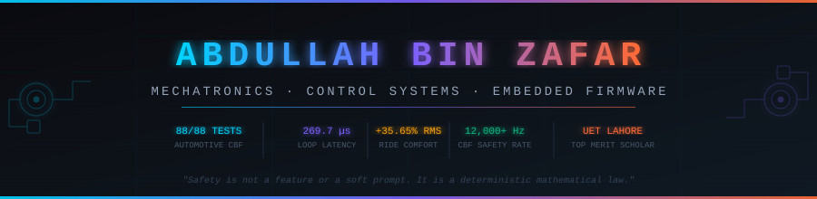

 

---

## ◈ EXECUTIVE ENGINEERING PROFILE

**Mechatronics & Control Systems Engineer** — B.Sc. Mechatronics & Control Engineering, **University of Engineering & Technology (UET) Lahore**, Top Merit Scholar (20 A/A+ grades across 6 semesters). Operating at the convergence of rigorous classical control theory, deterministic embedded firmware, and physical hardware realization.

<table>
  <tr>
    <td width="33%" align="center" valign="top">
       
      
        
      <b>Every Lab. Every Semester.</b> 
      Built, CNC-machined, PCB-routed, and hardware-validated every single engineering lab module — 6 semesters of 100% physical prototype delivery with empirical measurements: ±1 mm arm repeatability · &lt;50 mV power ripple · &lt;2° attitude margin · ±0.05 mm GD&T
    </td>
    <td width="33%" align="center" valign="top">
       
      
        
      <b>Industrial Automation</b> 
      Aug 26 – Sep 26, 2025 · Plant 2 HD2, Khurrianwala, Faisalabad. Optimized PLC automation, 3-stage valve pneumatic sequencing, closed-loop HVAC humidity control (±2% RH setpoints), and sensor signal conditioning on Wärtsilä V16 34DF 7.8 MW cogeneration plant.
    </td>
    <td width="33%" align="center" valign="top">
       
      
        
      <b>Pioneering AI Safety</b> 
      Author of the world's first unified MCP gateway + CBF-QP real-time safety filter — intercepts LLM commands in sub-millisecond real-time (&gt;12,000 Hz) and enforces strict forward invariance h(x) ≥ 0 ∀t ≥ 0 on physical robots with minimal L₂ perturbation.
    </td>
  </tr>
</table>

---

## ⚙️ Technical Competency Matrix

<table>
  <tr>
    <td width="22%" valign="top"><b>🧠 Control Theory &amp; Safety</b></td>
    <td>
      
      
      
      
      
      
      
      
    </td>
  </tr>
  <tr>
    <td valign="top"><b>⚡ Embedded Firmware &amp; Hardware</b></td>
    <td>
      
      
      
      
      
      
      
      
    </td>
  </tr>
  <tr>
    <td valign="top"><b>🏭 Industrial Automation</b></td>
    <td>
      
      
      
      
      
      
    </td>
  </tr>
  <tr>
    <td valign="top"><b>📐 CAD · CAM · CFD · PCB</b></td>
    <td>
      
      
      
      
      
      
    </td>
  </tr>
  <tr>
    <td valign="top"><b>💻 Software &amp; Systems</b></td>
    <td>
      
      
      
      
      
      
      
    </td>
  </tr>
</table>

---

## 🚀 Engineering Projects Portfolio

### 🏎️ Flagship R&D — Automotive Chassis Control

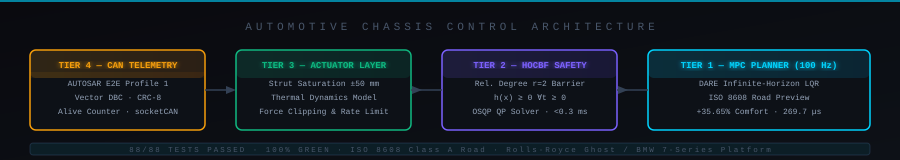

 

<table width="100%">
  <tr>
    <td width="100%" valign="top">
      <h3>
        <a href="https://github.com/EngineerAbdullahBinZafar/automotive-chassis-cbf">
          ⚡ Automotive Chassis CBF — HOCBF + Real-Time MPC + AUTOSAR E2E CAN
        </a>
        &nbsp;
        
        
        
      </h3>
      
<b>Executive chassis research framework for ultra-luxury automotive platforms (Rolls-Royce Ghost / Phantom Planar Suspension · BMW 7-Series Active Comfort Drive).</b> 
      Integrates a 100 Hz condensed linear MPC planner with DARE infinite-horizon terminal cost, a relative-degree r=2 High-Order Control Barrier Function (HOCBF) closed-form safety shield, physical actuator strut saturation/thermal dynamics, and an AUTOSAR E2E Profile 1 CAN telemetry gateway (<code>chassis_dynamics.dbc</code>).

      <table>
        <tr>
          <td align="center" width="25%">
             
            Over passive baseline on ISO 8608 Class A roads
          </td>
          <td align="center" width="25%">
             
            Median · &lt;3% CPU load at 100 Hz
          </td>
          <td align="center" width="25%">
             
            Suspension deflection mathematically guaranteed
          </td>
          <td align="center" width="25%">
             
            Complete automated test suite
          </td>
        </tr>
      </table>
       
      

        <code>Model Predictive Control (MPC)</code> · <code>HOCBF r=2</code> · <code>AUTOSAR E2E Profile 1</code> · <code>Vector DBC / socketCAN</code> · <code>ISO 8608 Road Roughness</code> · <code>OSQP Solver</code> · <code>Python / C++</code> · <code>GitHub Actions CI/CD</code>
      

    </td>
  </tr>
</table>

---

### 🤖 Autonomous Systems & Robotics

<table width="100%">
  <tr>
    <td width="50%" valign="top">
      
      <h3>
        ⚡ <a href="https://github.com/EngineerAbdullahBinZafar/principia-robotica">Principia Robotica</a>
        &nbsp;
        
        
      </h3>
      
<b>World's first unified MCP gateway + Control Barrier Function (CBF-QP) real-time safety engine for agentic robotics.</b> Intercepts LLM commands in sub-millisecond real-time (&lt;0.1 ms, &gt;12,000 Hz) and enforces strict forward invariance h(x) ≥ 0 ∀t ≥ 0 with minimal L₂ perturbation.

      

        
      

      
<code>Control Theory</code> · <code>CBF-QP</code> · <code>ROS 2</code> · <code>MCP Protocol</code> · <code>14 Robotic Tools</code> · <code>68/68 Tests</code>

    </td>
    <td width="50%" valign="top">
      <a href="https://github.com/EngineerAbdullahBinZafar/project-spidey-hexapod">
        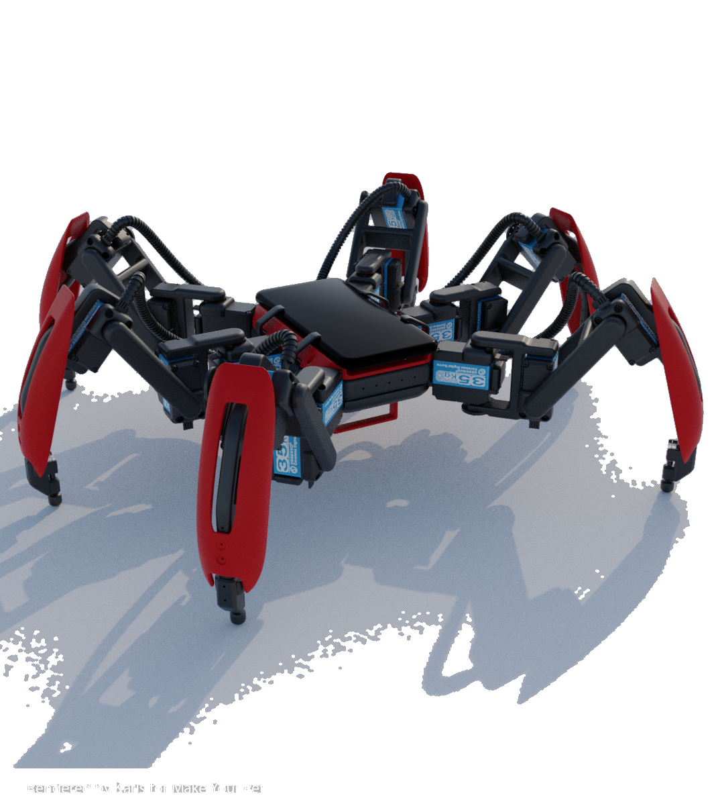
      </a>
      <h3>🕷️ <a href="https://github.com/EngineerAbdullahBinZafar/project-spidey-hexapod">Project SPIDEY — 18-DOF Hexapod (FYP)</a></h3>
      
<b>18-DOF bio-inspired autonomous walking hexapod robot — Final Year Project.</b> Engineered forward/inverse kinematics (DH parameters) supporting Tripod, Wave, and Ripple gaits on uneven terrain. Multi-channel synchronized PWM servo timing with STM32/RP2040, IMU stabilization, and fully CNC-machined chassis.

      
<code>Kinematics (DH)</code> · <code>STM32 / RP2040</code> · <code>Bio-Inspired Gaits</code> · <code>CNC Airframe</code> · <code>Real Hardware Built</code>

    </td>
  </tr>
  <tr>
    <td width="50%" valign="top">
      <table width="100%">
        <tr>
          <td width="50%">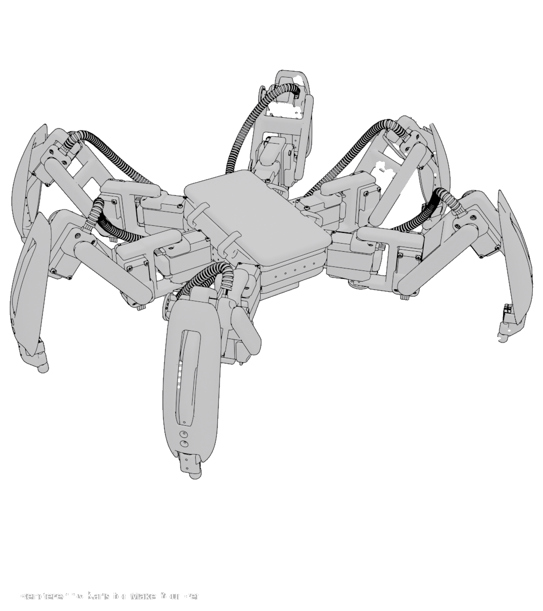</td>
          <td width="50%"></td>
        </tr>
      </table>
      <h3>🦾 3-DOF Kinematic Robotic Arm</h3>
      
<i>Supervisor: Dr. Dilruba Siddique</i> 
      Modeled DH parameters & Jacobians in MATLAB. Implemented closed-loop PID control per joint on STM32 with back-EMF compensation. CNC-machined aluminum linkages achieving <b>±1 mm end-effector positioning accuracy</b>.

      
<code>MATLAB/Simulink</code> · <code>STM32</code> · <code>RoboAnalyzer</code> · <code>CNC Machining</code> · <code>DH Parameters</code>

    </td>
    <td width="50%" valign="top">
      <table width="100%">
        <tr>
          <td width="50%">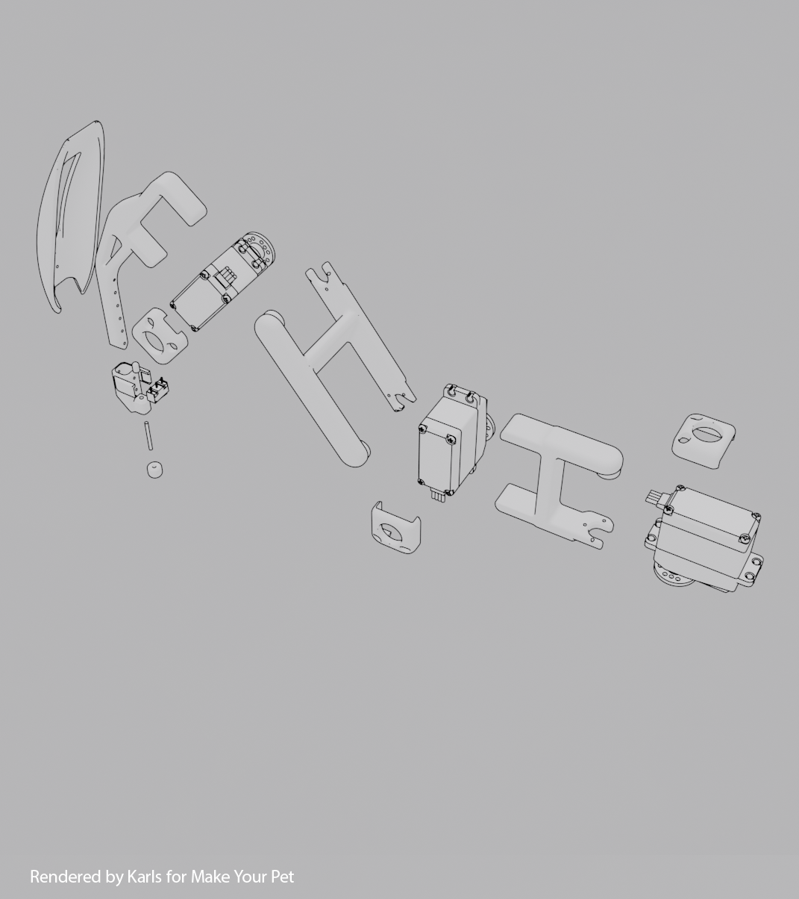</td>
          <td width="50%">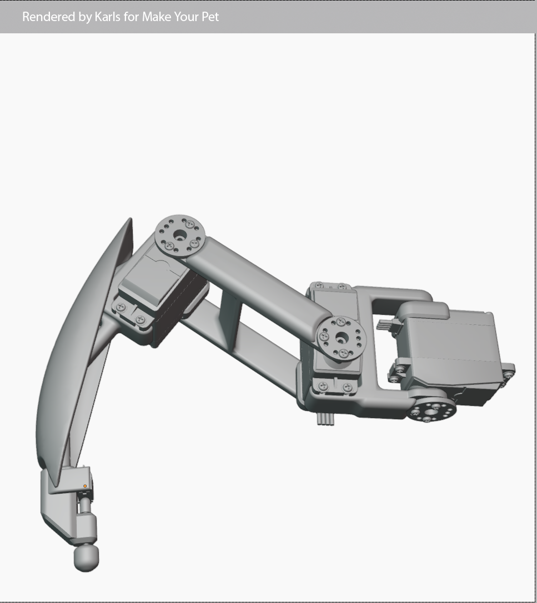</td>
        </tr>
      </table>
      <h3>🚁 Autonomous Racing Drone</h3>
      
<i>Supervisor: Dr. Muhammad Usman</i> 
      Custom quadcopter with ESP32 & MPU-6050 IMU. Fused sensor data via <b>Kalman filtering</b> & FIR filters, cutting control latency by ~40% and holding attitude error under <b>2°</b> with a 4.2:1 thrust-to-weight ratio.

      
<code>ESP32</code> · <code>MPU-6050 IMU</code> · <code>Kalman Filtering</code> · <code>FIR/IIR DSP</code> · <code>CNC Airframe</code>

    </td>
  </tr>
  <tr>
    <td width="50%" valign="top">
      <h3>🌐 <a href="https://github.com/EngineerAbdullahBinZafar/ros2-mcp-server">ROS 2 MCP Server</a>
        &nbsp;
      </h3>
      
<b>World's first Model Context Protocol server for ROS 2.</b> Connects Claude, Cursor, and AI agents directly to live ROS 2 topics, services, and node graphs with a hardware protection sandbox — enabling LLM-driven robotic control with safety guarantees.

      
<code>Python</code> · <code>ROS 2 Humble</code> · <code>MCP Protocol</code> · <code>Multi-Threading</code> · <code>Hardware Sandbox</code>

    </td>
    <td width="50%" valign="top">
      <h3>🛸 Line-Following Vision UAV</h3>
      
Vision-guided autonomous navigation drone utilizing OpenCV line-detection pipelines on custom KiCad-designed PCB, holding centerline deviation under <b>15 mm</b> with 20% lower latency than breadboard reference builds.

      
<code>OpenCV</code> · <code>Custom KiCad PCB</code> · <code>Arduino</code> · <code>Computer Vision</code> · <code>Embedded C++</code>

    </td>
  </tr>
</table>

---

### 🏭 Control, Power & Industrial Systems

<table width="100%">
  <tr>
    <td width="50%" valign="top">
      <h3>🌀 <a href="https://github.com/EngineerAbdullahBinZafar/vortex-100-fluid-amplifier">VORTEX-100 Fluid Amplifier</a></h3>
      
Industrial aerodynamic fluid amplifier & bladeless centrifugal system. Modeled 11-blade high-pressure impeller, volute diffuser plenum, and Coandă airfoil in SolidWorks — cutting power draw by <b>35%</b> with complete validated Bill of Materials (BOM) and rapid prototype assembly.

      
<code>Aerodynamics</code> · <code>Centrifugal Impeller</code> · <code>SolidWorks</code> · <code>CFD</code> · <code>Rapid Prototyping</code>

    </td>
    <td width="50%" valign="top">
      <h3>🔌 <a href="https://github.com/EngineerAbdullahBinZafar/ros2-hardware-bridge">ROS 2 Hardware Bridge</a></h3>
      
Lightweight serial bridge for STM32 microcontrollers using a custom CRC8 binary framing protocol for zero-loss, reliable serial communication between embedded firmware and ROS 2 nodes. Plug-and-play drop-in for any hardware robotics stack.

      
<code>ROS 2</code> · <code>STM32</code> · <code>CRC8 Protocol</code> · <code>UART DMA</code> · <code>Real-Time Comms</code>

    </td>
  </tr>
  <tr>
    <td width="50%" valign="top">
      <h3>⚙️ Closed-Loop DC Motor Controller</h3>
      
Designed closed-loop DC motor controller for heavy-duty drive applications using back-EMF compensation PID — boosting torque stability by <b>15%</b> and lowering energy consumption relative to open-loop baseline.

      
<code>Power Electronics</code> · <code>Closed-Loop PID</code> · <code>Back-EMF Compensation</code> · <code>Motor Drive</code>

    </td>
    <td width="50%" valign="top">
      <h3>💨 Automatic Pneumatic Safety Door</h3>
      
Simulated and engineered automated pneumatic actuation system with staged 3-valve logic and full pressure-drop analysis adhering to industrial safety protocols for guarded machinery access points.

      
<code>Electro-Pneumatics</code> · <code>Valve Sequencing</code> · <code>Pressure Analysis</code> · <code>Industrial Safety</code>

    </td>
  </tr>
  <tr>
    <td width="50%" valign="top">
      <h3>⚡ AC/DC Regulated Power Supply</h3>
      
Built full-wave rectified, LC-filtered regulated power supply from transformer through bridge down to output stage — achieving output voltage ripple strictly <b>below 50 mV</b> for sensitive precision electronics.

      
<code>Transformer</code> · <code>Full-Wave Rectification</code> · <code>LC Filter</code> · <code>Ripple &lt;50 mV</code>

    </td>
    <td width="50%" valign="top">
      <h3>🌱 Environmental Climate Controller</h3>
      
Embedded climate-control system holding relative humidity within <b>±2% of setpoint</b> using real-time sensor feedback loops — applied to textile and fiber production atmospheric control applications.

      
<code>Closed-Loop Control</code> · <code>DHT Sensors</code> · <code>Actuators</code> · <code>Industrial Telemetry</code>

    </td>
  </tr>
  <tr>
    <td width="50%" valign="top">
      <h3>📡 Multi-System Weather Station</h3>
      
Sensor integration and DAQ platform for real-time telemetry of ambient temperature, humidity, and environmental parameters over digital serial protocols with multi-channel data logging.

      
<code>DAQ Systems</code> · <code>Sensor Fusion</code> · <code>I²C / SPI Protocols</code> · <code>Serial Telemetry</code>

    </td>
    <td width="50%" valign="top">
      <h3>🎛️ Active Signal Conditioning Filters</h3>
      
Built and hardware-validated active low-pass and high-pass signal conditioning circuits using op-amps to attenuate sensor noise in high-precision measurement chains on industrial motor drive lines.

      
<code>Op-Amps</code> · <code>Active Filters</code> · <code>Signal Conditioning</code> · <code>Noise Attenuation</code>

    </td>
  </tr>
  <tr>
    <td width="50%" valign="top">
      <h3>📊 MATLAB / Simulink Control Portfolio</h3>
      
Modeled transfer functions, root locus, Bode/Nyquist stability for 2nd & 3rd order control systems; implemented digital FIR/IIR filters & FFT spectrum analysis across 6 semesters of control labs.

      
<code>MATLAB</code> · <code>Simulink</code> · <code>Bode / Nyquist</code> · <code>FIR/IIR Filters</code> · <code>FFT Analysis</code>

    </td>
    <td width="50%" valign="top">
      <h3>🏛️ <a href="https://thequietwealthjournal.vercel.app">The Quiet Wealth Journal</a></h3>
      
Architected a digital research publication exploring capital stewardship, operational leverage, and decision architecture for sovereign operators and founders. Full-stack build on Next.js, Sanity CMS, and Vercel Cloud.

      
<code>Next.js</code> · <code>Full-Stack</code> · <code>Sanity CMS</code> · <code>Vercel Cloud</code> · <code>Editorial Architecture</code>

    </td>
  </tr>
</table>

---

### 💻 Software, Systems & CAD Portfolio

<table width="100%">
  <tr>
    <td width="50%" valign="top">
      <h3>🧠 Python AI & OpenCV Applications</h3>
      
Integrated LLM/GenAI APIs for automated workflow execution and engineered OpenCV vision pipelines for real-time object detection, color segmentation, and autonomous guidance system prototyping.

      
<code>Python</code> · <code>OpenCV</code> · <code>GenAI / LLM APIs</code> · <code>Automation Pipelines</code>

    </td>
    <td width="50%" valign="top">
      <h3>✈️ Airline Management System (C++)</h3>
      
Terminal-based flight scheduling, passenger manifests, and ticketing system built in Modern C++ with custom dynamic memory management, persistent file I/O, and full OOP architecture.

      
<code>Modern C++</code> · <code>Dynamic Memory</code> · <code>File I/O</code> · <code>OOP Architecture</code>

    </td>
  </tr>
  <tr>
    <td width="50%" valign="top">
      <h3>💱 Real-Time Currency Engine (C++)</h3>
      
High-speed conversion engine utilizing custom hash maps for O(1) constant-time lookups across 40+ dynamic exchange rate pairs — demonstrating advanced data structures and algorithmic efficiency.

      
<code>C++</code> · <code>Hash Maps</code> · <code>O(1) Algorithms</code> · <code>Data Structures</code>

    </td>
    <td width="50%" valign="top">
      <h3>🎨 CAD & PCB Design Portfolio</h3>
      
Modeled 10+ SolidWorks assemblies to ±0.05 mm GD&T tolerance (CSWP Certified) & routed multi-layer KiCad PCBs with full DRC validation, silkscreen, and thermal via management.

      
<code>SolidWorks (CSWP)</code> · <code>GD&T (±0.05 mm)</code> · <code>KiCad PCB</code> · <code>CNC / CAM</code>

    </td>
  </tr>
</table>

---

## 🏭 Industrial Experience — Interloop Limited

### **Executive Intern Engineer** · Aug 26 – Sep 26, 2025

*Interloop Limited is one of the world's premier multi-category apparel & textile manufacturing multinationals — operating high-throughput automated knitting, spinning, and finishing plants at global scale.*

 

<table width="100%">
  <tr>
    <td width="50%" valign="top" align="center">
      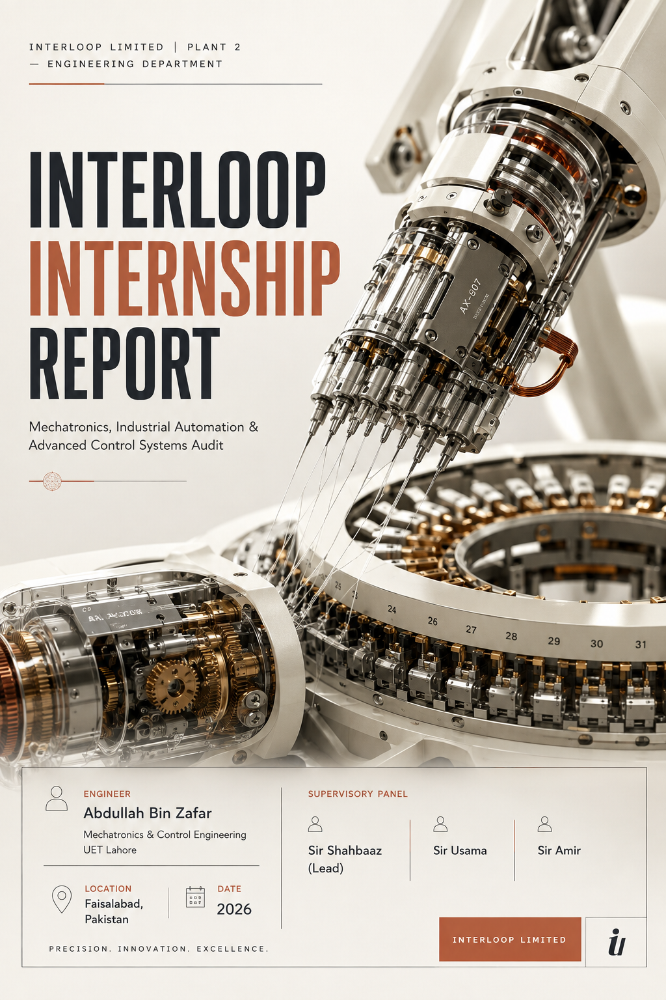
        
      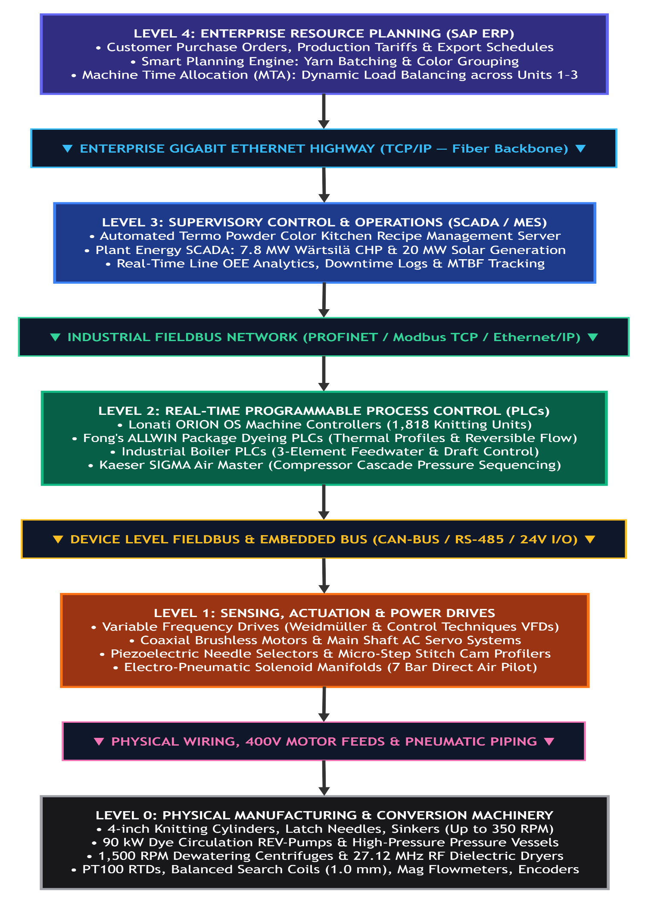
    </td>
    <td width="50%" valign="top" align="center">
      
        
      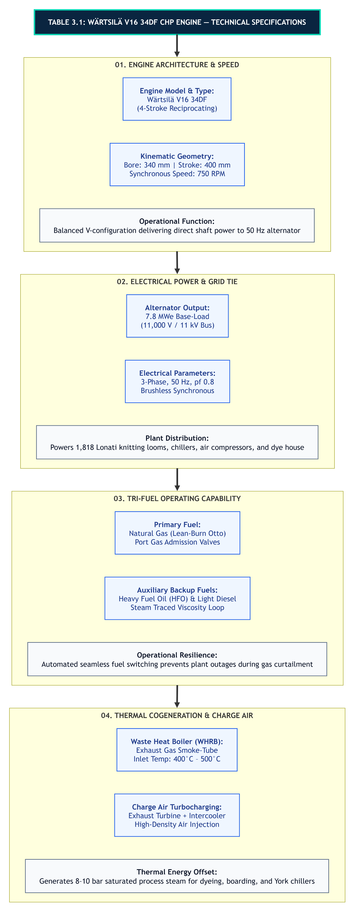
    </td>
  </tr>
</table>

<table width="100%">
  <tr>
    <td width="33%" valign="top" align="center">
      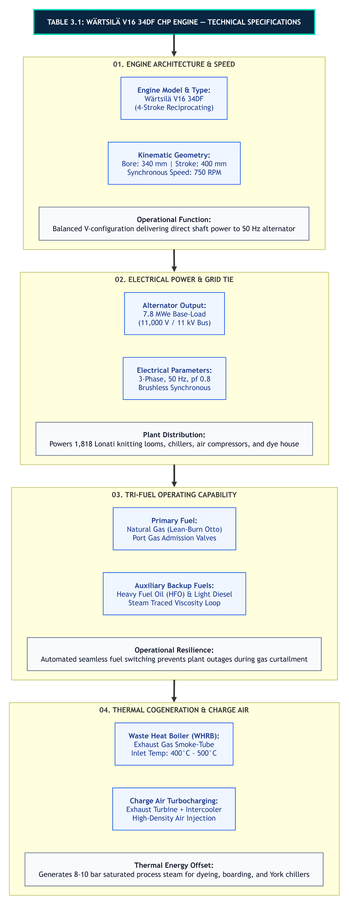
       
      <h4>⚡ Automation & Electro-Pneumatics</h4>
      
Audited high-speed production line pneumatic manifolds and air delivery loops. Optimized 3-stage valve sequencing — reducing pneumatic line pressure drops across machinery guard interlocks and cutting transient cycle delay across active production runs.

    </td>
    <td width="33%" valign="top" align="center">
      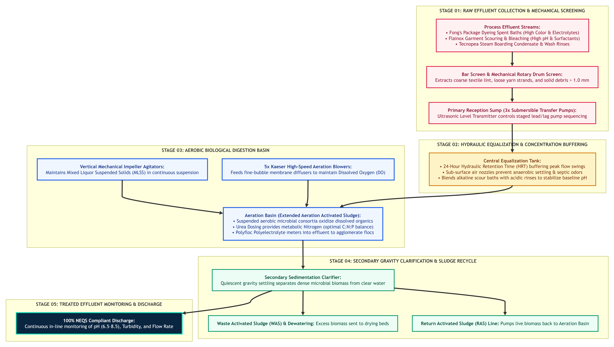
       
      <h4>🌡️ Closed-Loop Plant Telemetry</h4>
      
Calibrated environmental instrumentation and HVAC humidity feedback control loops, holding critical yarn/fiber processing atmospheric conditions strictly within <b>±2% relative humidity</b> setpoints across active production halls.

    </td>
    <td width="33%" valign="top" align="center">
      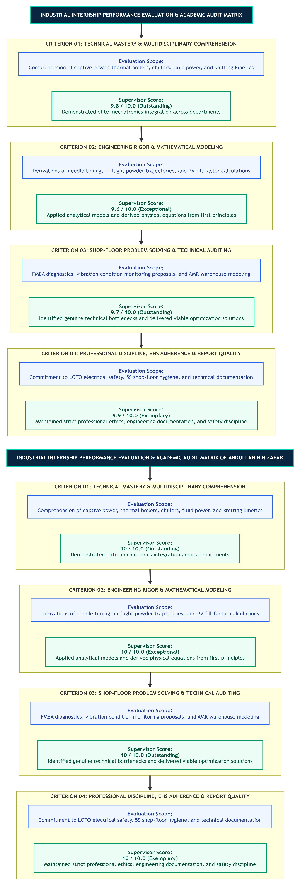
       
      <h4>🛠️ Diagnostics, PLC & Reliability</h4>
      
Assisted senior instrumentation engineers analyzing sensor signal noise on heavy motor drive lines. Tested op-amp active low-pass filtering and sensor conditioning to mitigate false-alarm line trip faults and enhance plant OEE.

    </td>
  </tr>
</table>

<table width="100%">
  <tr>
    <td width="50%" align="center">
      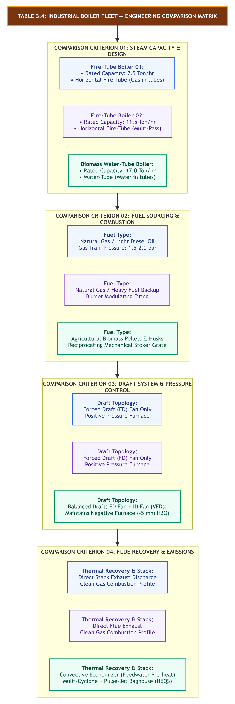
    </td>
    <td width="50%" align="center">
      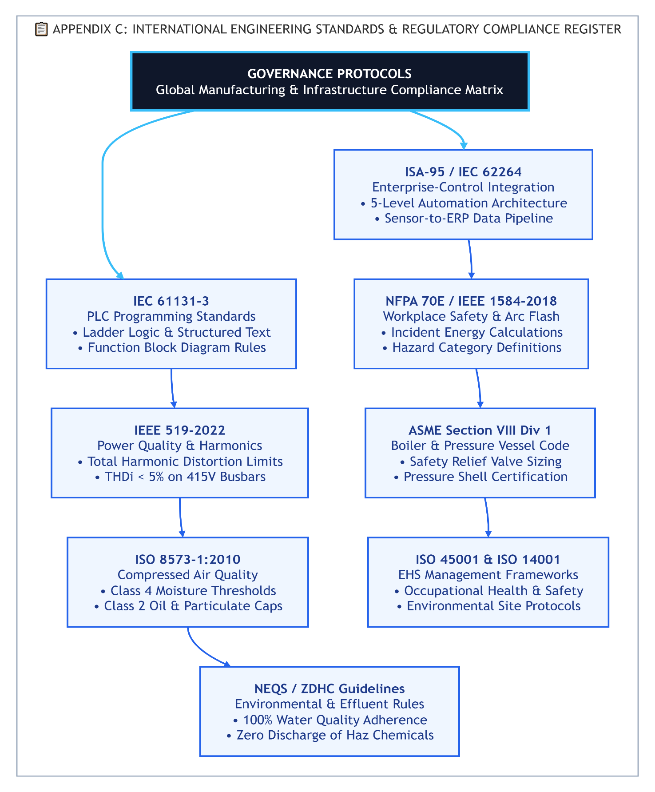
    </td>
  </tr>
</table>

 

| Detail | Information |
| :--- | :--- |
| **Department / Facility** | Engineering Department — Plant 2 (HD2), Khurrianwala, Faisalabad |
| **Role** | Executive Intern Engineer |
| **Period** | August 26, 2025 – September 26, 2025 (30 days) |
| **Industrial Supervisory Committee** | Sir Shahbaaz *(Lead Industrial Supervisor)* · Sir Usama *(Co-Supervisor)* · Sir Amir *(Co-Supervisor)* |
| **Systems & Machinery Analyzed** | Wärtsilä V16 34DF Tri-Fuel Cogeneration Engine (7.8 MW) · 1,818 Lonati Circular Knitting Robots · Fong's ALLWIN-166 HTHP Dyeing P&ID · Central Air Utilities & Absorption Chillers |
| **Official Documentation** | 162-page industrial audit report & certified supervisory evaluation rubric — completed and signed off |

---

## 🔬 Physical Laboratory Deliverables — 100% Hardware Build Rate

> Every single academic laboratory was backed by an operable, physical hardware prototype verified with empirical test data across 6 semesters.

| Laboratory & Module | Supervisor | Hardware Build & Measured Results |
| :--- | :--- | :--- |
| **Robotics & Mechanisms** | *Dr. Dilruba Siddique* | **3-DOF Kinematic Arm:** DH Jacobians in MATLAB · CNC-machined Al linkages · STM32 closed-loop PID → **±1 mm repeatability** |
| **Sensors & Embedded Control** | *Dr. M. Usman* | **Autonomous Racing Drone:** MPU-6050 6-axis IMU via Kalman fusion on ESP32 · **40% latency reduction** · attitude error **< 2°** at 4.2:1 thrust ratio |
| **Computer Vision Navigation** | *Faculty Team* | **Vision-Guided Line UAV:** Real-time OpenCV on custom KiCad PCB · centerline deviation **< 15 mm** |
| **Electrical Machinery & Power** | *Umar Siddique Virk* | **Regulated AC/DC PSU:** Transformer → full-wave bridge → LC filter → **< 50 mV** output ripple |
| **Industrial Hydraulics & Pneumatics** | *Dr. M. Awais Hafeez* | **Automated Safety Door:** 3-stage valve pressure-drop analysis · staged electro-pneumatic interlocks |
| **Machine Design & Elements** | *Dr. Imran Ali* | **Fatigue Life & Gear Train:** Multi-stage shaft & bearing design in SolidWorks under cyclic loading → **Grade A** |
| **Digital Logic Design** | *M. Zia Ur Rahman* | **Logic State Machines:** Combinational & sequential circuits · FSMs on breadboard & FPGA simulation |
| **Engineering Mechanics** | *Dr. Ammara Kanwal* | **Load-Bearing Folding Mechanism:** Shear-force & bending-moment predictions validated **within 5%** of theoretical |
| **Instrumentation & Systems** | *Faculty Team* | **Sensor Calibration & DAQ:** Calibration chains · active filter signal conditioning · multi-channel serial telemetry |

---

## 🏅 Certifications & Engineering Accreditations

| Domain | Certification | Issuing Body |
| :--- | :--- | :--- |
| 🎨 **Mechanical Engineering & CAD** | **Certified SolidWorks Professional (CSWP)** — Advanced 3D Modeling & Assembly Design | Dassault Systèmes |
| 📊 **Simulation & Model-Based Design** | **MATLAB Professional Certification** — Simulation & Model-Based Control Design | MathWorks |
| 🏭 **Industrial Manufacturing** | **Problem-Solving Certification** | Hyundai Nishat Motor (Pvt) Ltd. |
| 🧠 **AI & Machine Learning** | **Generative AI & Machine Learning Specialization** | Google / IBM / Microsoft |

---

## 📈 GitHub Activity

<a href="https://github.com/EngineerAbdullahBinZafar">
  
  &nbsp;&nbsp;
  
</a>

  

  

---

## 💼 Open for Elite Opportunities

**Targeting:** Global Autonomous Vehicle Teams · BMW · Mercedes · Waymo · Tesla 
Aerospace & Turbomachinery · Rolls-Royce · Airbus 
Advanced Industrial Automation · Siemens · ABB · Bosch

 

 

 

---

<i>"Safety is not a feature or a soft prompt. It is a deterministic mathematical law."</i>
 
<b>Abdullah Bin Zafar</b> · Mechatronics & Control Engineering · UET Lahore

